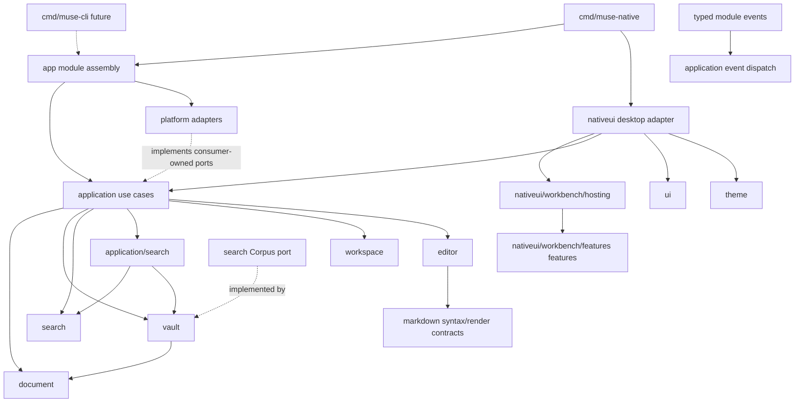

# Muse native architecture contract

Status: target architecture for the modular-monolith refactor. This document is the acceptance baseline for package moves and code wiring. If implementation disagrees with this contract, either change the implementation or record an explicit architecture decision here before continuing; do not silently preserve transitional structure.

## Goals

- Keep one native Go module and one desktop application while making feature ownership and dependency direction explicit.
- Allow roadmap features to add behavior through stable, typed module APIs rather than expanding `nativeui.App` or reaching into another module's internals.
- Keep document editing and Markdown rendering fast: avoid copies across package APIs, avoid per-frame global events, and keep caches/resource lifetimes with their owning feature.
- Complete the migration in one target architecture. Compatibility packages, duplicate implementations, old import paths, and temporary forwarding layers are not an acceptable end state.

## Reference basis

The UI architecture uses VS Code Workbench's separation between shell/core and feature-owned code as a structural reference. The stated 75% is an explicit 9-of-12 mapping of relevant source rules below, not a claim of source-code or visual similarity. It replaces the previous mixed `panels` / `surfaces` / `components` top-level taxonomy. Muse uses `workbench/features/<feature>` because these are ordinary first-party application modules; it does not adopt VS Code's contribution/extension registration model, dynamic extension host, Electron process model, or decorator-based service injection.

The remaining references are deliberately limited by concern:

- Joplin informs the separation between user-facing frontends and shared application services/models/storage, including reuse by desktop, mobile, and CLI. Muse's `application`, domain modules, and `platform` adapters own those layers.
- CodeMirror and ProseMirror inform the editor's internal state, view, command, and transaction boundaries. They do not define the overall NativeUI tree.
- GoRex informs MyGo-specific tab, split, pane-focus, and layout behavior. Its package layout is not copied wholesale.
- Anytype and Logseq are note-product comparisons for block presentation and document/UI state coordination. Anytype's published desktop source guide describes global `component`, `lib`, `store`, `model`, and `interface` areas with MobX stores and a gRPC middleware boundary; Logseq describes feature/function-oriented frontend code with document state in DataScript and UI state in atoms. These are useful product-specific examples, but they do not provide the same feature-boundary model as the primary reference. Anytype's desktop repository identifies its license as Any Source Available License 1.0.

The resulting NativeUI rule is: `nativeui/app.go` is the single UI assembly entrypoint; `workbench` owns shell composition, generic pane-host contracts, workspace presentation, command and focus contracts, and shared UI lifecycle; `workbench/features/<feature>` owns each feature's UI state, views, actions, and narrow application adapters. A feature may contain a panel, pane surface, dialog, or more than one of these; those are roles inside the feature, not competing top-level package taxonomies. `components` is reserved for small, genuinely reusable visual primitives. Feature packages expose a narrow public API and do not exchange private state. Workbench core does not import feature implementations; `app.go` wires them explicitly. There is no generic service locator, contribution registry, or dynamic plugin loader in this refactor.

### VS Code rule-to-package mapping

The source of the primary reference is Microsoft's published [source organization contract](https://github.com/microsoft/vscode/wiki/Source-Code-Organization/1a0b37e98b7c941127d4482f7ab8f51f95b15eeb), backed by the repository's [layer/contribution instructions](https://github.com/microsoft/vscode/blob/main/.github/instructions/source-code-organization.instructions.md). For a reproducible comparison, this table enumerates twelve relevant structural properties from those documents. Nine are adopted or translated to Muse's runtime; three are deliberately omitted, giving the approximate 9/12 (75%) figure.

| VS Code source structure/rule | Muse target | Treatment |
|---|---|---|
| `src/vs/base` and `src/vs/platform` separate general UI building blocks from shared platform services | `ui` and `platform` | Adopt: toolkit-neutral primitives and OS/runtime implementations stay below NativeUI |
| `src/vs/editor` is independent of Electron/Node runtime layers | `editor` and `markdown` | Adopt: editing and Markdown models remain independent of MyGo presentation |
| `src/vs/workbench` is the application workbench layer | `nativeui/workbench` | Adopt: shared shell, pane-host contracts, commands, focus routing and workspace projection live here |
| `src/vs/workbench/services` contains workbench-wide services | `nativeui/workbench/hosting`, `commands`, `focus` | Adapt: only genuinely cross-feature UI services belong here; feature-only services remain with their feature |
| `src/vs/workbench/contrib/<feature>` groups feature-owned implementations | `nativeui/workbench/features/<feature>` | Adapt the ownership boundary; Muse uses ordinary feature packages and explicit composition, not VS Code contribution registration |
| Feature APIs limit cross-feature reach-through | `<feature>/api.go` where another feature needs a stable seam | Adopt the boundary principle; expose APIs only when there is a real consumer |
| Code outside a feature cannot depend on its private internals | Workbench core imports no feature packages | Adopt directly |
| Features do not reach into another feature's internals | Cross-feature access through a narrow API or application use case | Adopt directly |
| Feature-only services stay feature-local | Feature-local constructors and dependencies | Adopt the ownership principle; no global service locator |
| Runtime-specific `common/browser/electron-*` package split | No corresponding package split | Omit: Muse has one MyGo native UI runtime, with OS-specific code in `platform` |
| Dynamic VS Code extension host/contribution ecosystem | No dynamic loader in this refactor | Omit: features are statically linked; a plugin runtime is a separate future capability |
| Decorator/service-identifier dependency injection | Explicit Go constructors and typed ports | Omit the mechanism; retain constructor injection without a global container |

The nine adopted/adapted rows define the approximate 75% reference correspondence; the last three state explicit non-correspondences. This ratio is a review aid for architecture choices, not a universal mathematical measure of codebase similarity.

### `hosting` and interaction responsibilities

Neither `hosting` nor a generic `interactions` package is a one-to-one VS Code package mapping. VS Code separates editor opening/activation (`IEditorService`), editor groups (`IEditorGroupsService`), editor-area presentation (`EditorPart`), and view placement (`ViewsService`). Muse's `workbench/hosting` is a Muse-specific adapter seam that unifies only the live pane/window slot contract needed by its generic pane manager; it owns stable host handles, placement, focus ownership and lifecycle, and must not own a feature's view state. Durable tabs/splits remain in `workspace`; MyGo layout translation remains in `workbench/workspace`; feature content and its transient state remain in `features/<feature>`. GoRex is a behavioral analogue for tab/split/pane state and presentation, but keeps these responsibilities in its app package rather than defining a generic host package; its `host.go` is specifically a machine-information popover.

`interactions` is a directory group, not a Go package or catch-all manager. Command registration/dispatch, keybinding resolution, context rules, logical panel navigation, and cross-feature drag/drop keep separate packages because they have distinct APIs; feature-specific handlers stay with their features. Shared command contracts/dispatch go in `workbench/interactions/commands`, panel focus order in `workbench/interactions/focus`, context facts/rules in `workbench/interactions/context`, sequence matching in `workbench/interactions/keybindings`, and shared payload/native transfer adaptation in `workbench/interactions/dragdrop`. Pane/content focus ownership remains in `workbench/hosting` because it manages hosted pane lifecycle and native focus transitions, rather than logical interaction ordering.

`workbench/interactions/focus` owns ordered panel focus movement. `workbench/interactions/context` is a separate, deliberately small UI-condition model inspired by VS Code's context-key expressions and Zed's nested key contexts. A context scope contributes facts; a resolved immutable snapshot overlays scopes from workspace to pane to focused control, with the nearest scope winning. Features own and name their keys (for example `explorer.hasSelection`, `editor.mode`, `search.open`); the shared package owns typed key/value access, snapshot composition, and pure rules (`equals`, `not`, `all`, `any`).

Commands and keybindings may reference the same pure rule so menus, enablement, and input routing agree. Evaluating a rule is side-effect free; dispatch still checks availability before running the action. Action-specific arguments remain separate from context facts. Start with typed in-process keys and rules; add a text parser, user-configurable context names, change-event bus, or dynamic registration only when a product feature needs them. This is not Go's `context.Context`, an application state store, or a replacement for domain rules. `focus` produces/updates focus facts, `hosting` performs native focus transitions, and feature-owned state produces its own context facts.

### Complementary references and exact scope

| Reference | Source structure or rule | Muse mapping |
|---|---|---|
| Joplin | [Frontend is separate from shared services, models, and database; desktop/mobile/CLI use the shared backend](https://joplinapp.org/help/dev/spec/architecture/) | `nativeui` calls `application` and domain APIs; `cmd/muse-cli` can use the same application layer without NativeUI |
| CodeMirror / ProseMirror | [State and view are separate](https://codemirror.net/docs/guide/); [model, state, view, and transform are separate packages](https://prosemirror.net/docs/guide/) | `editor` owns session/transactions/commands; `nativeui/workbench/features/editor` owns MyGo presentation and host adaptation |
| GoRex | [`state.go` owns tabs/split/persistence; `view.go`, `tabs.go`, and `commands.go` present pane behavior](https://github.com/egoist/gorex); `host.go` is the machine-information popover, not a generic pane host | `workspace` and `nativeui/workbench/workspace` follow its state/presentation split; Muse's `workbench/hosting` has no direct GoRex package counterpart |
| Zed | [Active key contexts form a Workspace → Pane/Panel → Editor tree with boolean and ancestor-match expressions](https://zed.dev/docs/key-bindings#contexts); [GPUI attaches actions and key contexts to element subtrees](https://github.com/zed-industries/zed/blob/main/crates/gpui/docs/key_dispatch.md) | Use scoped context composition and context-aware action resolution as the reference for `workbench/interactions/context`; do not copy GPUI's Rust entity/context runtime |
| Anytype | [Published frontend layout separates `component`, `lib`, `store`, `model`, and `interface`](https://github.com/anyproto/anytype-ts/blob/develop/docs/src/ts/README.md); [gRPC API is the frontend/middleware boundary](https://github.com/anyproto/anytype-ts/blob/develop/docs/src/ts/lib/api/README.md) | Compare block/document presentation and API boundary only; do not copy the global technical-category tree. The client identifies itself as open code under ASAL 1.0. |
| Logseq | [Frontend components/handlers/workers and document DB vs UI state](https://github.com/logseq/logseq/blob/master/CODEBASE_OVERVIEW.md) | Compare document/UI state coordination and worker ownership; it does not define Muse's NativeUI feature boundary |

## Target package tree

```text
native/
├── app/                           # composition root and module lifetime
├── cmd/muse-native/               # thin executable entry point
├── cmd/mdshot/                    # Markdown rendering inspection utility
├── cmd/searchbench/               # search benchmark utility
├── application/                   # cross-module user use cases
│   ├── agent/                     # agent session and tool workflows
│   ├── document/                  # open/save/export note workflows
│   ├── config/                    # typed settings persistence port
│   ├── vault/                     # open/switch/refresh vault workflows
│   ├── search/                    # interactive search scheduling and result-navigation workflows
│   └── workspace/                 # restore and persist session workflows
├── events/                        # minimal typed in-process event contract
├── document/                      # durable note model and policies
│   ├── date/                      # note date parsing and normalization
│   ├── frontmatter/
│   ├── repository.go              # note/recovery ports and domain errors
│   └── types/                     # stable value types only
├── vault/                         # vault identity and note relationships
│   ├── files/                     # discovery/catalog
│   ├── index/                     # note metadata and parsed structure projections
│   ├── links/                     # resolution/backlinks
│   └── watch/                     # watcher lifecycle and vault event policy
├── search/                        # query domain and search execution
│   ├── query/                     # syntax, AST, validation
│   ├── fields/                    # type/tags/time semantics
│   ├── plan/                      # query compilation/execution
│   ├── rank/                      # scoring and time-aware ranking
│   └── quickopen/                 # path/title/alias candidate matching and ranking
├── workspace/                     # tabs, active view, layout and restoration
├── editor/                        # public editing-session facade and composition
│   ├── input/                     # keymap, Vim modes and command interpretation
│   │   └── vim/                   # Vim mode state machine, prefixes and command mapping
│   ├── navigation/                # source-position movement and structural navigation
│   ├── findreplace/                # current-buffer match ranges and source replacement operations
│   ├── source/                    # editor source/revision bridge to Markdown syntax
│   ├── layout/                    # editor block geometry and virtualized layout policy
│   ├── blocks/
│   │   ├── inline/
│   │   ├── paragraph/
│   │   └── table/                 # table editing subsystem
│   └── internal/
│       └── core/                  # editor-private buffer/transaction primitives
├── markdown/                      # public Markdown parse/render facade
│   ├── syntax/
│   ├── render/
│   ├── images/
│   ├── math/
│   │   └── texcanvas/             # native canvas integration for TeX rendering
│   └── diagrams/
├── agent/                         # provider-neutral conversation and tool value model
├── config/                        # serialized settings, defaults and migration
├── theme/                         # runtime palette and visual tokens
├── ui/                            # reusable UI primitives
│   ├── scrollbar/
│   └── iconlibrary/
├── nativeui/                      # thin NativeUI facade; no feature policy or duplicate feature state
│   ├── app.go                     # sole UI assembly entrypoint and typed cross-feature action router
│   ├── run.go                     # thin public desktop entrypoint delegating to workbench/shell runtime
│   ├── workbench/
│       ├── shell/                 # app chrome, overall workbench layout and MyGo runtime lifecycle
│       ├── hosting/               # Muse-specific live pane host contract, focus and lifecycle
│       ├── workspace/             # MyGo projection of tabs/split tree to hosted pane slots
│       ├── interactions/          # workbench-wide interaction systems
│       │   ├── commands/          # typed command registration/dispatch contracts
│       │   ├── context/           # scoped UI facts and composable command conditions
│       │   ├── focus/             # ordered panel focus movement, independent of toolkit handles
│       │   ├── keybindings/       # platform-neutral key strokes and sequence matching
│       │   └── dragdrop/          # cross-feature drag values and native transfer adapters
│       ├── diagnostics/           # opt-in runtime and resource diagnostics
│       ├── rendering/             # shared cross-feature rendering systems
│       │   └── markdown/          # reusable MyGo Markdown and media presentation
│       └── features/              # first-party feature-owned UI modules
│           ├── editor/            # note editor surface and its UI-specific subsystems
│           ├── explorer/          # file tree and vault navigation feature
│           │   └── filetree/      # Explorer-owned tree projection, transient state and rendering subsystem
│           ├── outline/
│           ├── search/            # workspace search and current-document find/replace views
│           ├── quickopen/         # transient file chooser surface; matching stays in search/quickopen
│           ├── backlinks/
│           ├── imagedocument/     # image opened as a workspace document
│           ├── imagepreview/      # transient image preview pane
│           ├── mermaidpreview/    # transient Mermaid preview pane
│           ├── linkpreview/       # transient wiki/link preview
│           ├── properties/
│           ├── commandpalette/
│           ├── settings/
│           ├── vaulthome/         # Vault landing page actions and presentation
│           ├── agent/
│           └── dialogs/           # feature-owned or shared dialog presentations
│               ├── document/      # conflict, recovery, and metadata migration dialogs
│               ├── export_host.go
│               └── mygo_pdf_renderer.go
│   └── components/                # only low-level, cross-feature visual primitives
├── platform/                      # OS/runtime adapters
│   ├── agent/                      # external AI provider HTTP adapters and wire protocol
│   ├── externalopener/            # open URLs/files with the host system
│   ├── cachepath/                  # OS/XDG cache-root policy
│   ├── process/
│   │   └── vaultsearchindexer/    # indexer process reconciliation/lifecycle
│   └── filesystem/
│       ├── documentstore/         # concrete note/recovery persistence
│       ├── configstore/           # user settings JSON files and config-root policy
│       ├── imagecache/            # atomic image cache persistence
│       ├── temporaryimages/       # temporary image files for unsaved documents
│       ├── exportstore/           # exported document writing
│       ├── filemetadata/          # platform file metadata reads
│       ├── imagefiles/            # image source file access
│       ├── naviconstore/          # concrete per-vault icon preference persistence
│       ├── recentstore/           # concrete recent-document persistence
│       ├── vaultfiles/             # concrete vault file operations
│       ├── vaultindexsource/      # concrete recursive source for vault indexing
│       ├── vaultfilessource/      # concrete source for vault catalog discovery
│       ├── vaultsearchstore/      # concrete persistent search-index storage
│       ├── workspacestore/        # concrete workspace snapshot persistence
│       └── watcher/               # concrete filesystem watcher
└── locales/                       # localization data and generated catalog
```

Each feature is a regular Go package. The composition root wires the feature explicitly; it may expose a narrow API when other modules need one. Its internal organization follows the feature's needs, for example:

```text
nativeui/workbench/features/editor/
├── surface/            # one editor instance hosted in a workspace pane
├── inputadapter/       # MyGo key/text normalization and the Vim prompt view
├── navigation/         # editor-host navigation integration
├── ime/                # text composition and IME host lifecycle
├── session/            # transaction and history integration
├── render/             # rich-text projection and MyGo painting
├── blocks/             # inline, paragraph, table, and media UI adapters
├── navigationrail/     # heading rail presentation
├── textlayout/         # MyGo-backed shaping and layout cache
└── feedback/           # transient cursor/search/yank visuals
```

The role is not to force every feature into the same subdirectory template. The invariant is ownership: a feature keeps its state, UI, commands, and feature-only adapters together; a narrow API is added when needed. Shared workbench code may define host contracts, but it may not import feature implementations.

Directory levels follow one classification axis: a category directory groups peer capabilities of that category, while a concrete capability owns its implementation parts beneath it. Do not place a category next to one of its own concrete members (for example, `interactions/` beside `dragdrop/`), or place a leaf value/type package beside a complete system. `workbench/interactions/` groups independently useful workbench interaction systems; drag payload values and native transfer conversion are one cohesive `interactions/dragdrop` capability. `workbench/rendering/` groups reusable presentation systems shared by multiple features; Markdown drawing and resource presentation are owned by `rendering/markdown`. `features/` groups complete user-facing features, and a child package beneath a feature is a substantial internal subsystem. Keep implementation parts under their owning capability, and split them only when there is a real dependency boundary or independent reason to change. Explorer's `filetree` is an Explorer-owned subsystem, not a generic framework package.

The immediate `workbench/` children are all top-level ownership areas; their code volume and internal depth may differ because they cover different scopes. Their classification remains explicit and non-overlapping:

| Area | What it groups or owns | Why it is a peer of the other workbench areas |
|---|---|---|
| `features/` | Complete user-facing UI features | Product-facing behavior belongs to a feature owner |
| `interactions/` | Cross-feature input, commands, focus, context, keybindings, and drag/drop | Shared user interaction mechanics belong together; feature handlers remain with features |
| `rendering/` | Reusable drawing systems consumed by multiple features | Shared presentation is separate from each feature's interaction and lifecycle |
| `shell/` | App chrome, event pumping, and toolkit lifecycle | Owns application-frame presentation and runtime, not feature policy |
| `workspace/` | MyGo presentation of tabs/splits and hosted pane slots | Owns layout projection, not durable layout policy or host lifecycle |
| `hosting/` | Generic live pane/window host contract and lifecycle | Owns stable host handles and placement across features |
| `diagnostics/` | Opt-in runtime and resource diagnostics | Owns cross-cutting observation, not product behavior |

This is not a requirement for equal folder counts or equal code size. The balance check is whether each sibling is a top-level ownership area and whether a category and one of its members have accidentally become peers. A category with one child is reviewed for whether the category adds a real semantic boundary; it is not retained solely for hypothetical future growth.

The balance review also checks how responsibility is distributed among siblings, not just whether the names fit the same category. Siblings should each represent a comparably complete responsibility at that layer. Do not split a small implementation piece into its own sibling while leaving adjacent responsibilities as broad, complete systems; either place that piece under its owning system or split the adjacent responsibilities along the same architectural axis. This does not require equal size or equal internal depth. For example, `interactions/dragdrop` is a complete cross-feature interaction capability under the interaction group; its payload types do not sit beside unrelated workbench systems as a separate top-level area. When a proposed package is only a thin adapter for one operation, first check whether it belongs inside the feature/session that owns that operation rather than creating a new peer.

The command registry, typed context rules, key-sequence matcher, logical panel-focus router, and cross-feature drag/drop transfer are independently testable parts of workbench interaction handling, so they sit together under `workbench/interactions/` without merging their distinct APIs. A subpackage remains only if production wiring uses it; a test-only abstraction is not sufficient reason to keep a standalone module.

`nativeui/app.go` is the only root assembly file: it creates the shell and feature APIs from injected dependencies and routes typed cross-feature actions. `nativeui/run.go` is only the public desktop entrypoint and delegates MyGo lifecycle to `workbench/shell`. No root-level `*_composition.go`, feature action handler, feature adapter, or application workflow is part of the target layout. Feature-specific MyGo/action adapters live inside their owning `workbench/features/<feature>` package; generic pane/window placement and focus lifecycle live in `workbench/hosting`; workbench-wide window rendering and runtime event pumping live in `workbench/shell`; policy spanning document/vault/search/workspace modules lives in the owning `application/<domain>` service. Do not add a catch-all composition package.

| Existing NativeUI area | Target feature/core owner |
|---|---|
| `panels/filetree`, `filetree_panel.go`, and tree-local state in `app.go` | `workbench/features/explorer`; generic list/tree mechanics are private to its `filetree` child package |
| `panels/outline` | `workbench/features/outline` |
| `panels/search` and `panels/findreplace` | `workbench/features/search` (query and replacement semantics stay in `search` / `editor/findreplace`) |
| `surfaces/noteeditor` and `components/editor` | `workbench/features/editor` |
| `surfaces/quickopen` | `workbench/features/quickopen` (candidate matching remains in `search/quickopen`) |
| `surfaces/backlinks` | `workbench/features/backlinks` (resolution remains in `vault/links`) |
| `surfaces/imagepreview`, `surfaces/imagedocument`, `surfaces/mermaidpreview` | Separate `workbench/features/imagepreview`, `imagedocument`, and `mermaidpreview` features |
| `panels/properties`, `panels/commandpalette`, `panels/settings`, `panels/agent`, `panels/naviconpicker` | Corresponding feature modules; shared settings/vault policy stays in its owning application/domain module |
| `panels/vaulthome` | `workbench/features/vaulthome`; workspace session and persistence remain in `workspace` / `application/workspace` |
| `components/markdown`, `components/linkpreview` | `workbench/rendering/markdown` for shared Markdown drawing; `workbench/features/linkpreview` for the user-facing link preview |
| `window`, `workspacepresenter` | `workbench/hosting` for live pane contracts; `workbench/workspace` for MyGo layout projection |
| `components/doctypes` | `document/types` for document-kind policy; UI-specific renderer selection remains in the owning feature |
| `components/icons`, `components/windowcontrols` | `components/icons`, `workbench/shell/windowcontrols` |

The child entries in this tree are real Go package boundaries, not merely folders used to group files. `editor` is the public editing facade; `workbench/rendering/markdown` is the shared native renderer consumed by editor and preview features. They should compose focused subsystems rather than retain large implementation bodies. A subsystem may stay in its parent package only when it shares private invariants that cannot yet be expressed through a narrow typed contract. Do not create one-file packages or empty forwarding shells just to match the tree.

### Editor extraction map

`native/editor` is not intended to stay flat. The current files are large and some mix policy with MyGo rendering, so migration must split by responsibility rather than move each file wholesale. The main groups are:

| Target package | Responsibility | Current flat-file families to inspect and split |
|---|---|---|
| `editor` facade | Public `Session`, neutral input/transaction/frame types, and composition only | Keep the public API small (`api.go`, `session.go`); do not leave the current `Editor` view implementation as the production facade |
| `editor/internal/core` | Buffer, selection, undo/history, source transactions, system patches | Core portions of `editor.go`, `edit.go`, `transaction.go`, `history.go`, `operations.go`, `multirange.go`, and `system_patch.go` |
| `editor/source` | Incremental synchronization from editor source revisions to the Markdown syntax parser, including editor-only comment/frontmatter masking and source-offset preservation | `parsed.go`, `mask.go`, and parser-source tests |
| `editor/input` | Toolkit-neutral key/text event and operation contracts shared by keymaps | `event.go`, `key_event.go`, `operation.go`, and `sequence.go` |
| `editor/input/vim` | Independent Vim mode state machine, pending prefixes/counts/registers, and mapping from neutral key/text events to typed intents | `modal.go`, Vim-specific command interpretation, and mode/sequence tests; expose a narrow Host contract for editor effects |
| `editor/navigation` | Source-position movement, grapheme boundaries, and structural navigation policy | `nav.go`, `comment_nav.go`, `editor_grapheme.go`, and movement policy currently mixed into Vim/navigation files |
| `editor/findreplace` | Case-insensitive current-buffer matching, source ranges and safe single/all replacement planning | Current-document `findHits`, snippet/range generation, and replacement planning in `nativeui.App` |
| `editor/layout` | Backend-neutral block and viewport geometry, visible-range indexing, virtualization, and scrolling policy | Geometry and virtualization portions of `layout.go`; horizontal offset/reveal/bar geometry and virtual-row policy from `horizontal_scroll.go` and `vim_virtual_image_rows.go` |
| `editor/blocks/inline` | Inline formatting, pair insertion/skip rules, math editing state, wiki/tag/comment behavior | Semantic portions of `format.go`, `inlinemath.go`, `wikilink.go`, `tag.go`, and `comment.go`; auto-pair and closer-skip policy from `nativeui/workbench/features/editor/editor_edit.go` |
| `editor/blocks/paragraph` | Heading/list/fold/break behavior, typed block shortcuts, and paragraph transactions | `folding.go`, `typed_breaks.go`, `paragraph`/heading/list portions of editor commands; fenced-code/math shortcut construction from `nativeui/workbench/features/editor/editor_edit.go` |
| `editor/blocks/table` | Table selection model, hit testing, grid geometry, and row/column operations | Semantic portions of `table_document_selection.go`, `table_region_*.go`, `table_virtual_edit.go`, and `table_visual_modes.go` |
| `nativeui/workbench/features/editor` | MyGo input/render adapter, editing interaction orchestration, IME, painting, scroll event translation, and block-specific UI | MyGo-dependent portions of `view.go`, `display.go`, `paint.go`, `ime.go`, `rectangle.go`, `assets.go`, `source_highlight.go`, `image_controls.go`, `table_*_ui.go`, `table_edges.go`, `table_cell_menu.go`, and `table_reorder.go`; host scroll input/indicator adapters |

The table entries are responsibility guides, not mechanical move lists: files that combine model behavior and UI must be split before their owners change. Tests move with the package that owns the tested behavior; Vim mode/command tests belong with `editor/input/vim`, movement semantics belong with `editor/navigation`, UI/input adapter tests belong with the component adapter, and transaction tests stay with the core. A package is justified when it has a coherent contract and more than a forwarding file.

An `_adapter.go` filename does not itself establish a module boundary. Keep an adapter when it translates between a consumer-owned contract and a concrete toolkit, operating-system, or host capability. The adapter should have one clear direction and no duplicate feature state. A `*Editor` receiver that reads private state may stay in the component root as a narrow host bridge, but rendering policy and feature behavior stay with their owning package. Forward-only compatibility shims and duplicate implementations are migration leftovers and must be removed before completion.

Vim remains a selectable editor input strategy, not a second editor core. Its state machine owns mode transitions, command prefixes/counts, register selection, and key-to-intent mapping. It sends typed intents through a narrow Host callback; the host resolves source/selection context and dispatches editor operations without exposing `Editor` fields or buffer/history to Vim. `editor/navigation` implements movement semantics, `editor/blocks/*` implements block operations, and `editor/internal/core` commits edits. The UI adapter translates MyGo events to neutral input events and renders the current mode label/command prompt from an immutable Vim view state.

Text shaping needs an explicit backend boundary. `editor/layout` owns neutral block, viewport, scrolling, and virtualization policy. MyGo scroll event translation and indicator lifecycle stay in the editor feature host. The current shaping implementation imports MyGo and therefore belongs under `nativeui/workbench/features/editor/textlayout`; it must not stay under `editor` or `editor/internal`. If a backend-neutral shaping algorithm is extracted later, it can live behind that feature package's narrow input/output contract without depending on MyGo.

The editor source adapter does not duplicate Markdown grammar or AST ownership. `editor/source` coordinates the editor's incremental source/revision and masking needs, then delegates Markdown syntax parsing and AST updates to `markdown/syntax`; it may not define a second Markdown AST or parser grammar. This is a public editor subsystem package, rather than an `internal` package, because `nativeui/workbench/features/editor` must be able to consume it without violating Go's `internal` import boundary.

`editor.Session.Frame` is a neutral source snapshot containing only revision, source text, and selection. It must not carry a Markdown AST, rendered block tree, toolkit object, or cache. `editor/source` owns the source-to-syntax projection; Markdown parsing and render models remain in `markdown`. `nativeui/workbench/features/editor` may keep a separate immutable viewport frame containing only visible UI blocks and presentation resources.

`editor/blocks/*` owns the behavior and session state of each block subsystem; table syntax and parsed structure remain in Markdown, while table selection and edits belong to `editor/blocks/table` and table painting/input belongs to the editor UI component. Rich-text input rules such as auto-pairing, Markdown block shortcuts, list continuation, structural Enter/Backspace behavior, and semantic table selection are editor policy, not UI behavior. UI adapters may inspect parser-projected geometry and translate toolkit events, but must ask the owning editor or block subsystem for the resulting operation/transaction.

### Editor UI component extraction map

`nativeui/workbench/features/editor` is the MyGo integration host for the editor feature; its child packages own cohesive presentation, input, navigation, and block behavior. A child package may not contain files that merely declare `package editor`. Since Go keeps unexported state private to a package, the root may retain only host operations that must read or mutate `Editor` state directly. Move independent policy and rendering into the owning child package and cross that boundary with immutable values and narrow typed callbacks. Do not expose `Editor`, parser leaves, mutable session internals, or caches as a shortcut.

| Target package | Owns | Candidate current files / required seam |
|---|---|---|
| `workbench/features/editor` | Editor host, construction, lifecycle, scroll event translation, and narrow host bridges for child components | Keep the host lifecycle, MyGo scroll input/indicator handling, orchestration, and methods that must read private `Editor` state to implement child-owned capabilities; table host translation stays here while table view/actions stay in the table component; keep feature view/state/policy in child packages and do not export broad mutable state |
| `workbench/features/editor/session` | Applying a validated editor transaction through the authoritative domain session | `transaction.go` accepts a domain `Session` and value transaction; parser synchronization and feature-owned history snapshots stay in the feature host because they require private presentation state |
| `workbench/features/editor/inputadapter` | Pure MyGo key/text normalization and physical shortcut mapping into editor input values, plus Vim prompt presentation | `key_event.go`, `shortcut.go`, and `modal_command_line.go`; editor effects stay behind feature-root host callbacks, while Vim commands, operations, grapheme, and mode semantics stay in `editor/input/vim` |
| `workbench/features/editor/ime` | MyGo text-composition lifecycle, UTF-16 range conversion, and text-input client contract | `client.go`, `state.go`, and `index.go`; the feature-root IME host implements narrow source-edit and geometry capabilities |
| `workbench/features/editor/blocks/inline` | Inline-link suggestion/hover UI and host-side inline actions | Move wiki suggestion popup state and link interaction adapters here; consume `editor/blocks/inline` source ranges and typed actions |
| `workbench/features/editor/blocks/inline` | Inline formatting command adapter over the source-level inline subsystem | `editor_format.go`; keep delimiter/range policy in `editor/blocks/inline` and limit the feature adapter to host facts and applying returned edits |
| `workbench/features/editor/blocks/paragraph` | Fold affordances, fold host state, and paragraph-specific interactions | `folding_host.go` and `typed_breaks_host.go` with fold-chevron and typed-break UI adapters; heading/source policies remain in `editor/blocks/paragraph` |
| `workbench/features/editor/blocks/table` | MyGo table view, hit testing, selection handles, and typed table action contract | `tableui.go` and `selection_ui.go`; expose immutable frames and typed actions through `tableui.Host`; Editor-specific parser/session translation stays in the feature root's table host adapters |
| `workbench/features/editor/blocks/media` | Image, math, and diagram controls/presentation and UI resource lifetime | `image_controls.go`, `math_preview.go`, and `diagram_preview.go`; resolve leaf/source access through a typed media host |
| `workbench/features/editor/render` | Paint detached visible frames; own reusable block, callout and HTML projection, display-map, visibility, code-window, typography, and source-token presentation | `Frame`/`Block`/`Overlay` values and `Paint`; `ProjectCallouts` and `ProjectHTMLBlock` consume detached inputs. The Editor host may adapt parser leaves, caches and hit-tested geometry into values, but the renderer never receives `Editor`, parser nodes, source models, selection state, or mutable caches. |
| `workbench/features/editor/navigation` | Reusable visible-text/source coordinate mapping with no editor or toolkit state | `mapping.go`; editor movement and layout-aware host resolution stay in the feature host and delegate source-position policy to `editor/navigation` |
| `workbench/features/editor/navigationrail` | Heading-rail rendering, hover/preview presentation, and interaction state | `view.go` and `policy.go`; it consumes an immutable heading frame and typed preview/jump callbacks, never an `Editor` or source model |
| `workbench/features/editor/feedback` | Transient visual feedback and animation state | `smooth_cursor.go`, `search_match_pulse.go`, `vim_yank_flash.go`; keep source selection and movement authoritative in `editor` |
| `workbench/features/editor/textlayout` | MyGo-backed shaping and text-layout cache | Existing package; keep it dependent on backend drawing types and independent from editor session policy |

The table records the intended owners and their seams. It is the acceptance contract for the implementation: package declarations, imports, tests, and runtime wiring must match these boundaries; a directory-only move or temporary bridge does not satisfy it. Semantic editing behavior remains in `editor`, `editor/navigation`, and `editor/blocks/*`; UI packages translate host events, supply toolkit facts such as hit-tested source ranges, apply returned transactions through the editor session, and present resulting state. The editor feature's navigation adapter owns display-to-source mapping only; source movement semantics remain in `editor/navigation` and the relevant block subsystem. The feature root produces revision-tagged heading snapshots and passes values plus typed callbacks to the navigation rail, which never receives an `Editor` handle.

`markdown/syntax` owns Markdown parsing and AST values. `markdown/render` maps parsed values to rendered blocks. `images`, `math`, and `diagrams` own their bounded media/rendering pipelines and caches; they expose results to the renderer without depending on the editor session. The root `markdown` package is the stable entry point for common parse/render operations.

For very large Base64 image destinations, the exact Markdown recognition and synthetic inline-token fast path belong to `markdown/syntax`: it must preserve canonical parse token kinds and byte ranges and must not decode image bytes. A source-revision cache belongs with the editor's source projection, while decoding, pixel budgets and decoded-resource caching stay in `markdown/images`; MyGo image placement and controls stay in `nativeui/workbench/features/editor/blocks/media`. Do not let this parser optimization become a second Markdown grammar or a UI-owned syntax rule.

`search/quickopen` owns fuzzy matching across candidate path, title, and aliases, including rank and rune-based highlight positions. `nativeui/workbench/features/quickopen` owns the chooser's transient query/selection view state and presentation; it consumes ranked candidates and returns typed actions. Mermaid parsing and diagram models remain in `markdown`; `nativeui/workbench/features/mermaidpreview` owns transient viewport state and MyGo presentation.

`nativeui/workbench/hosting` owns Muse's generic runtime host contract for windows and panes: stable handles, placement, focus ownership, and content lifecycle. It does not attempt to reproduce VS Code's separate editor-group, editor-area, and view-container services as one implementation, and it never imports a feature package or exposes concrete feature state. `workspace` owns durable tabs, active documents and split descriptors; `nativeui/workbench/workspace` translates them into MyGo layout and emits typed actions. This follows GoRex's observable division of split state from its view/host code, while keeping Muse's durable layout model out of UI packages.

Each package under `nativeui/workbench/features/<feature>` owns the state and presentation for that feature. Add an `api.go` only when another module needs a supported seam. `nativeui/app.go` constructs concrete feature APIs once; the root `App` delegates rendering and feature lifecycle to `workbench/shell` and stores only typed API references needed for cross-feature routing. Workbench core depends only on contracts and shared components; it does not import feature implementations. Cross-feature calls use the callee's public API or an application use case, never private state. Feature policy stays in `application`, `vault`, `search`, `document`, `editor`, or `agent`.

The editor feature composes one pane's document workflow and `editor.Session` into hosted content. It owns its editor instance and transient cursor/view state; `workspace` owns portable restore descriptors. The app routes pane commands using `FocusedPane` and typed capabilities rather than retaining parallel editor state. Persisted workspace data contains no widgets, bitmaps, or feature-private state.

Openable document-kind policy belongs in `document/types`, not a UI component package. A feature may expose a renderer through its public API; renderer selection must not make document policy depend on MyGo or Markdown presentation.

### NativeUI responsibility audit and target ownership

This audit is against the current `architecture/reference-layout` worktree. File and symbol names below are the evidence baseline for the next wiring passes. It separates UI-owned state and runtime mechanics from use-case policy: a UI event handler is not a business leak merely because it calls an application service, and a pure view model is not a use case merely because it contains conditional presentation logic.

#### Responsibility boundary

| Concern | NativeUI may own | Must move or remain in application/domain | Current evidence and target |
|---|---|---|---|
| Input and presentation state | Focus, selection used only by a control, hover, scroll, open/closed state, typed UI actions, dialog choices, display formatting and toolkit handles | Durable or cross-feature rules derived from those values | `workbench/features/explorer/state.go`, `features/search/state.go`, feature controllers and views are appropriate owners for transient UI state. They return intent; they do not own filesystem or index truth. |
| Runtime event delivery | Polling a channel from a MyGo frame, posting back to the UI thread, invalidating, translating native drag formats, showing localized errors | Retry/coalescing decisions, stale-result acceptance, mutation policy and cross-module transition ordering | `vault_lifecycle_composition.go:vaultTick` may remain the UI event pump; its policies are split out below. `workspace_lifecycle_composition.go:setEventDispatchers` may subscribe and marshal callbacks to the UI thread. |
| Composition | One root constructor creating feature APIs and a typed router for actions that cross feature boundaries | Feature-local action adaptation, application workflows, and rules usable without NativeUI | Only `nativeui/app.go` constructs shell/features and routes typed cross-feature intents. A root file named `*_composition.go` is not a target seam: it must move to its feature, shared workbench host, or owning application module. No feature may receive `*App` as a shortcut. |
| Native host | MyGo window placement, focus lifecycle, modal restrictions, toolkit rendering and native dialogs/clipboard/drag transport | Durable tabs/panes, document identity or file-operation policy | `workbench/hosting/manager.go` owns generic live content handles, placement, focus and lifecycle. `workbench/workspace/presenter.go` owns MyGo split-tree projection. Neither owns document or feature state. |

#### Workflow inventory

| Responsibility domain | Current rules/use cases/persistence/scheduling/state and evidence | Target ownership and exact UI boundary |
|---|---|---|
| Document open, save, dirty transition, recovery and external changes | `application/document/session.go` and `workflows.go` already own save identity, dirty-transition and merge/recovery decisions; `save.go`, `metadata.go`, `metadata_editor.go`, `inspector.go`, `export.go`, and `core_metadata_migration.go` hold document use cases. `document_session_composition.go` adapts the editor session. Leaks remain in `app.go:openFileDialog`, `openPathNow`, `requestOpen`, `applyOpen`, `save`, `saveAs`, `updateManagedTimestamp`, and `vault_lifecycle_composition.go:reconcileExternalCurrentDocument/reconcileExternalNote`: these read repositories, classify/open content, decide reload-vs-merge effects, and coordinate metadata/save transitions in the UI root. | `application/document` owns openability, dirty transition, save-as/create timestamp, save scheduling/reconciliation, history/recovery and typed outcomes. `document/types` owns document kind/extension policy; `platform/filesystem/documentstore` performs I/O. NativeUI asks for a file path or user decision, passes it to a use case, binds the returned note/outcome to the editor pane, restores focus/caret, and presents a dialog/notice. `documentTick` may poll an async result and marshal it to the UI thread; it must not choose persistence policy. |
| Vault lifecycle, index, catalog and active-note indexing | `application/vault/session.go` coordinates index/catalog/watcher lifetime and publishes snapshots/results; `directory_catalog.go` adapts child lookup; `application/vault/active_link_index.go` has an active-note update ticket. `vault_lifecycle_composition.go:vaultTick` creates/closes sessions and drains results (runtime lifecycle is legitimate), but `linkIndexTick` owns its timer/worker/stale-ticket acceptance, while `handleVaultResult` mixes invalidation with search selection, external-document policy, navigation and feature refresh. Root `app.go:children/treeCatalogChildren/catalogEntry/pathKind` translates catalog facts. | `application/vault` owns vault session lifetime, watcher/index reconciliation, path/catalog facts and link-index freshness. UI may own the frame callback that polls `Results`, forwards the result to a typed application transition, and renders the new snapshot. A result handler in NativeUI is limited to view invalidation, notices, focus/scroll and routing a returned command; it must not synthesize index state or decide which revision wins. Explorer may own visibility filtering, row ordering and flattening because those are tree projections. |
| Workspace search and stale-result navigation | Search syntax, fields, plans and ranking belong to `search/{query,fields,plan,rank}`; `search/quickopen` owns candidate matching/cache. `application/vault/session.go` currently exposes `ScheduleSearch`, `ForceSearch`, and `ValidateSearchNavigation`; `application/vault/quick_open.go` constructs candidates. UI query/mode/selection/list scroll in `features/search/state.go` is valid transient state. `vault_lifecycle_composition.go:syncWorkspaceSearchQuery/navigateSearchHit/postVaultNavigation/acceptSearchHit` and `app.go:workspaceSearchDialog` currently own cadence, deferred hit navigation, result freshness/requery and acceptance decisions. `native/search/scheduling.go` holds the coalescing deadline policy. | Add the narrow `application/search` workflow (not a generic coordinator): it owns interactive query generations, coalescing/debounce policy, active-document overlay inputs, result freshness and stale-hit revalidation/requery. It consumes `search` semantics and a narrow vault snapshot/read/navigation capability from `application/vault`. `application/vault` remains owner of vault index/session lifecycle. `features/search` owns query text, mode, selection, scrolling and rendering. UI reports input changes, schedules its next frame for a returned duration, polls typed results, and routes a valid selected result to the document-open/navigation use case. Quick Open matching remains in `search/quickopen`; its catalog/index candidate source remains `application/vault.QuickOpen`; the quick-open feature owns only the chooser surface and selection. |
| Explorer create, move, copy, trash, import and drag/drop | `application/vault/file_operations.go` and `file_usecases.go` already own root confinement, collision handling, symlink checks and mutation outcomes. `explorer_composition.go` translates typed feature actions. Leaks remain in `app.go:applyTreeNativeDrop`, which decides same-vault default Move versus Copy, and in `moveTreeItems`, `trashTreeItems`, `applyRename`, `importDroppedInto`, and `openDropped`, which mix path kind/product semantics with UI cache refresh and document relocation. `treeNativeDragOptions/treeItemsTransferData` are native transport mechanics and belong in the adapter. | `application/vault` owns drop intent policy, target normalization, create/move/copy/trash/rename/import and returned path remapping facts. `document/types` owns accepted document kinds. Explorer owns rows, expansion, selection, drop target, and visual operation projection. NativeUI serializes OS drag payloads, converts native modifiers/operation into an explicit `DropIntent`, passes paths to the use case, then applies returned path remaps to currently hosted panes and invalidates affected views. It must not duplicate path validation or choose collision policy. |
| Workspace switch, restore, tabs/panes and recents | `workspace` owns durable tab/pane/layout values; `application/workspace/session.go` owns state transitions/focus fallback and `restore.go` persistence; `recents.go` owns recent ordering, retention, live filtering; `document_history.go` owns recent document navigation. `workbench/hosting/manager.go` owns live host handles; `workbench/workspace/presenter.go` projects the durable split tree. UI `workspace_lifecycle_composition.go:persistWorkspaceState/syncWorkspaceDocument/restoreWorkspaceState/applyRestoredWorkspace/closeWorkspacePaneSurfaces` currently mixes editor cursor capture and pane creation with state repair, active-pane selection and restoration policy. `app.go:setWorkspace` resets durable session data and transient Explorer state in one method. | `application/workspace` owns vault/session transitions, restore validation, document descriptors/cursor persistence, tab/pane focus fallback, and recent-history policy. The workspace domain owns serializable values and invariants. `workbench/hosting` owns only live handles/focus/lifecycle; `workbench/workspace` owns MyGo split rendering. NativeUI supplies pane descriptors/cursor snapshots, creates and closes feature content for returned pane plans, and maps host focus to the selected pane. On vault switch it asks the workspace use case to replace the session, then separately clears/tears down old UI surfaces and Explorer transient state. Recent list rendering belongs to the invoking feature; opening a selected recent entry is routed by kind through workspace/document use cases. |
| Properties, metadata and backlinks | `document/frontmatter` owns parsing/value representation; `application/document/metadata_editor.go` owns metadata source edits and `inspector.go` owns derived document inspection. `vault/links` and `application/vault.Session` own backlinks. `features/properties/controller.go/state.go` correctly own inspector open/edit/presentation state, the frontmatter-to-view projection, and field-display preference behavior. Leakage remains in `app.go:propertySystemProperties/propertyVaultPath` and the `New`-time `appPropertyMetadata` adapter, which computes system-property snapshots and binds metadata mutation logic; the controller also queries backlink facts directly through a callback. | `application/document` returns a typed metadata-inspection snapshot and owns metadata edit validation/application. `application/vault` returns backlink facts. The properties feature maps frontmatter and those facts to display fields, owns pinned/hidden/order preferences and drafts, and emits typed commands; preference persistence uses `application/config`/a feature-owned preference port. NativeUI supplies current document/vault snapshots and routes commands; it does not count words, derive system metadata, resolve backlinks, or rewrite YAML. |
| Wiki links, heading links, embeds and previews | `vault/links` owns wiki target parsing/resolution and the vault session owns indexed note/link facts. `markdown/syntax` owns heading slug semantics. `features/linkpreview` owns hover/dismiss/placement state; `workbench/rendering/markdown` paints preview content. Leaks remain in `app.go:openLink/openWiki/resolveWikiLinkStyle/resolveWikiEmbed/resolveWikiPreviewNote`, which convert paths, decide whether a failed anchor falls back, choose pending-index behavior and build the link-preview note projection. | Put target interpretation and fallback semantics in `application/vault` link-navigation use cases over `vault/links`; heading slug/source lookup stays in `markdown/syntax` plus `editor/navigation`. NativeUI translates click/hover events, supplies viewport bounds, requests a resolved destination, opens/focuses the correct feature surface, and presents a preview. Path resolution and anchor-fallback rules must not be restated in event handlers. |
| Agent tools that edit or mutate workspace content | `application/agent` already owns session/streaming, approval/tool policy and capability-driven execution. Provider HTTP is in `platform/agent`; transcript/controller state is in `features/agent`. `assistant_composition.go:appAssistantWorkspace` currently performs document reads/writes, applies edits to the active editor, constructs vault file use cases for move/trash/create, and refreshes indexes from callbacks. | `application/agent` continues to request typed capabilities. The composition root injects document and vault application capabilities and translates active-pane edits on the UI thread. Tool policy remains in `application/agent`; file confinement/mutation remains in `application/vault`; document save/revision policy remains in `application/document`. The UI adapter may marshal a confirmed active-pane edit to the UI owner and update host views; it may not be the implementation of the tool's filesystem/document use case. |
| Configuration and appearance | `config` owns serialized settings/defaults; `application/config` owns repository workflows; `theme` owns palette tokens. `features/settings` owns form/page state. `app.go:dispatchSettingsAction`, `editor_settings_composition.go`, and `settings_preferences.go` currently duplicate settings state and route each form action into config/theme/editor effects. | `application/config` owns read/validate/persist/update transitions for user settings. UI may preview transient theme/editor values and dispatch typed changes; committed values are applied to the relevant feature and theme. Keep MyGo-specific system appearance calls and rendering values in NativeUI/theme, but avoid parallel persisted-setting copies or policy in `App`. |
| Export and dialogs | `application/document/export.go` owns format preparation and base-name/URL policy; `features/dialogs.ExportHost` owns native save-dialog orchestration over typed `ExportPorts`, `MyGoPDFRenderer` supplies the platform renderer, and `features/dialogs/document.MigrationHost` owns migration-modal/preview lifecycle over application ports. | Keep PDF rendering/OS save dialogs at the platform/UI edge; keep export content semantics and document recovery/migration decisions in `application/document`. The feature gathers typed choices, asks for paths, invokes use cases through narrow ports and presents outcomes. |

#### Root composition-file migration map

The current root composition files are not accepted as permanent root organization. Each is an explicit migration item; only constructor statements that merely instantiate an already-owned feature API may be folded into `nativeui/app.go`. A file does not qualify as “wiring only” if it reads product state, chooses a workflow, owns a feature action loop, handles persistence, or performs policy.

| Current root file | Target location and split |
|---|---|
| `app.go` | Retain only `Dependencies`, `New`, feature/shell construction, typed application capability injection, and typed cross-feature routing. Move window state, `View`, shell layout, MyGo events and runtime callbacks to `workbench/shell`; move feature-owned handles/actions/adapters to their feature packages; move product policy to the owning `application/<domain>` service. |
| `run.go` | Move MyGo startup, menu/window callbacks, close/quit lifecycle and runtime configuration to `workbench/shell/runtime.go`; retain at most a thin public `Run(dependencies)` facade. |
| `assistant_composition.go` | Move transcript/view/controller-specific adapters to `features/agent`; move tool workspace orchestration to `application/agent` using `application/document` and `application/vault` capabilities. `app.go` only injects those APIs and dispatches a typed request to the active pane. |
| `document_session_composition.go` | Move editor-session-to-document-port adaptation into `features/editor`; keep conflict/recovery/history dialog action handling in `features/dialogs/document`; retain save/reconcile policy in `application/document`. |
| `editor_settings_composition.go` | Move editor presentation application to `features/editor`, settings action mapping to `features/settings`, and durable load/validate/save to `application/config`. |
| `explorer_composition.go`, `explorer_file_creation_composition.go` | Move Explorer view building, feature action handling, selection/drop/create-target adaptation into `features/explorer`. Keep file mutation and new-note policies in `application/vault` / `application/document`; route “open this document” as a typed cross-feature action through `app.go`. |
| `explorer_keys_composition.go` | Move Explorer-specific key handling and key-to-feature-action mapping into `features/explorer`; use `workbench/interactions/keybindings` for shared sequence primitives and `workbench/interactions/focus` for shared ordered focus movement. |
| `export_composition.go` | Move export-dialog/format action adaptation and the MyGo PDF renderer/save-panel adapter to `features/dialogs/export_host.go`. `application/document` continues to own export content preparation. |
| `image_document_composition.go` | Move image-document controller construction and open/close/action adaptation into `features/imagedocument`; use `workbench/hosting` for generic placement/lifecycle. |
| `migration_composition.go` | Move preview/dialog state and action translation into `features/dialogs/document`; candidate planning and migration application stay in `application/document`. |
| `vault_file_operations_composition.go` | Move root/destination/move/import/drop policy into `application/vault`; keep only native drag decoding in `features/explorer` and UI cache invalidation/notice adaptation at the feature boundary. |
| `vault_lifecycle_composition.go` | Move query cadence/freshness to `application/search`, vault/index/link freshness and external-change transitions to `application/vault` plus `application/document`, link/backlink navigation to their application/feature owners. The MyGo frame poller and thread hop move to `workbench/shell`; the root router only forwards resulting typed actions. |
| `workspace_lifecycle_composition.go` | Move session transitions/restore/persistence/recents to `application/workspace`; move MyGo pane-tree and pane-factory coordination to `workbench/workspace`; keep the generic live content host in `workbench/hosting`. Only typed action routing may remain in `app.go`. |
| `workspace_recent_composition.go` | Keep ordering, retention, live filtering and persistence in `application/workspace`; move each recent-list projection to its owning feature (`explorer` or `workspace`); route an open choice as a typed document/workspace action. |

After migration, `nativeui/app.go` may retain dependency fields as references to constructed APIs, but not parallel copies of document, vault, query, workspace, settings, or feature state. For any feature that needs current state, inject a narrow capability returning an immutable value snapshot (`ActiveDocument`, `VaultStatus`, `WorkspaceSnapshot`) or a typed action port. For a user action, the feature sends a typed request to its owning application use case; for cross-feature navigation it emits a typed intent that the root router translates. Never inject `*App`, expose arbitrary field getters/setters, or capture the root in a callback that lets a feature perform multi-step policy. If a request requires inspecting or updating several domains, move that sequence to the existing owning application service (or add only a narrowly named application service when no owner exists), not back to `nativeui/app.go`.

#### Feature-package review

| Feature package | Legitimate owned behavior | Application/domain boundary to keep |
|---|---|---|
| `features/editor` and `workbench/rendering/markdown` | MyGo editor surface, input normalization, Vim interaction, selection/viewport/layout/painting, and reusable Markdown drawing consumed by editor and preview features | Editing transactions, undo/history, Vim command semantics and block transformations belong to `editor`; syntax/render values and image/diagram/math interpretation belong to `markdown`. App callbacks may expose narrow link/asset/open capabilities; do not make the editor surface the owner of vault resolution or persistence. |
| `features/explorer`, `features/outline`, `features/backlinks` | Tree expansion/selection/flattened rows/drop feedback; outline and backlink presentation, row navigation and scrolling. `features/explorer/filetree` owns Explorer's tree view model, transient interaction state and rendering; the parent Explorer feature owns the public host/action boundary. | Catalog/link facts come from `application/vault` and `vault`; open/navigation goes through document/workspace use cases. File mutation and path rules are not tree policies. |
| `features/search`, `features/search/findreplace`, `features/quickopen` | Search/find panel query text, mode, selection, list/scroll state; Quick Open window lifecycle and chosen row | Query parsing/execution/ranking, interactive scheduling and result freshness belong to `search` / `application/search`; current-buffer find/replace ranges and replacements belong to `editor/findreplace`; Quick Open candidates/matching live in `application/vault` plus `search/quickopen`. |
| `features/properties` | Inspector presentation, edit drafts, source-mode UI, per-field display preferences and mapping typed facts to rows | Frontmatter value rules belong to `document/frontmatter`; inspect/edit workflows to `application/document`; backlinks to `application/vault`/`vault/links`; durable user settings to `application/config`. |
| `features/agent` | A real Go feature package exposing `Host`, assistant rendering/actions, and transient panel state; its typed `Ports` are the only route to settings UI/persistence, provider discovery, Markdown drawing, document navigation/insertion, notifications and invalidation | Conversation/session, tool authorization, provider/model operations and typed workspace mutation requests belong to `application/agent`; transport belongs to `platform/agent`; mutations route through document/vault use cases. The feature package must not import or retain `nativeui.App`; shell composition constructs `Host` and adapts its narrow ports. |
| `features/imagepreview`, `imagedocument`, `mermaidpreview`, `linkpreview` | Preview/document surface state, zoom or hover/placement, and feature-local resource handles; Markdown drawing is provided by `workbench/rendering/markdown` | Target resolution, file-kind and vault containment decisions belong to `application/vault` / `document/types`; concrete image/file access belongs to platform ports. Resource/cache lifetime may remain feature-owned when it is derived render state. |
| `features/vaulthome`, `features/settings`, `features/naviconpicker`, `features/commandpalette`, `features/dialogs` | Vault-home and settings forms, icon-picker selection, command palette `Host` (candidate snapshot, query/selection projection, render and typed `Execute(ID)` / dismiss actions), dialog-local choices and validation feedback | Workspace restoration/recents, persisted settings, icon preference persistence, command availability/product workflows, document/export/migration decisions belong to their application/domain owners. The root composes the command candidate snapshot and routes the selected stable ID; the feature never receives `*App` or command callbacks. |

This review applies to controller code as well as `view.go`: a feature controller is still UI-layer code. It may own a view-state transition, local validation needed to guide a form, and projection; it may not become a second document/vault/search/workspace service. Likewise, “adapter” in a filename is not evidence that a file is only an adapter: inspect its decisions and side effects against the table above.

The following existing code is intentionally **not** a leak: Explorer's visible-row projection and context-menu state; search panel query text, mode and selection; Properties' editing draft and pinned/hidden/order presentation preferences; editor key/text normalization, Vim command presentation, hit testing, virtualized layout and rendering; window/pane handles and focus lifecycle; MyGo frame polling, `RunOnMain`, invalidation, dialog/clipboard/native drag invocation; localization and display formatting. A responsibility moves only when it enforces product/data invariants, performs cross-module workflow ordering, owns persistence/scheduling policy, or must have the same meaning without NativeUI.

During wiring, use narrow value snapshots and typed requests/results. Do not solve any row above with a generic `coordinator`, `composition`, or `manager` package. Extend an existing application module when the use case is owned there; add a focused application module only where a real workflow spans modules and currently has no owner (`application/search` is the concrete case). Avoid `func(*App)` feature ports: an adapter should expose the smallest operation and immutable snapshot that the feature needs. `nativeui/app.go` is the only root assembly/router; feature-specific adapters and action handlers belong inside their feature package, shared toolkit hosting belongs in `workbench/hosting`, workbench-wide UI lifecycle belongs in `workbench/shell`, and cross-domain policy belongs in the existing `application/<domain>` service.

`editor/navigation` owns source-position navigation semantics; MyGo event translation, focus, painting, text measurement, and viewport geometry stay in `nativeui/workbench/features/editor`. `editor.Session` exposes backend-neutral input intents, transactions, and immutable revision frames. `nativeui/workbench/rendering/markdown` paints the neutral Markdown model for editor and standalone preview callers; individual features retain their own interaction state and lifecycle. `platform/cachepath` owns OS/XDG cache-root policy, while feature modules receive cache storage through consumer-owned ports. Media decode/cache policy remains with the feature that owns it, and concrete filesystem access remains in platform adapters.

## Ownership and model boundaries

| Module | Owns | Must not own |
|---|---|---|
| `document` | Durable `Note` path identity, metadata, source/revision semantics, save/conflict/recovery policies | Cursor, selection, focus, scroll, widgets, parsed render nodes |
| `editor` | Mutable `Buffer`, edit transactions, undo/redo, selection, input mode, navigation and block editing | Vault indexing, persistence implementation, durable note identity, OS APIs |
| `markdown` | Markdown syntax/AST and derived rendering structures for inline, paragraph, table, image, math and diagrams | Durable note aggregate, editor selection/commands, application panel state |
| `vault` | Vault identity, file catalog, index lifecycle, link resolution/backlinks and watcher-to-vault policy | Search query language/ranking, native UI, document editing buffer |
| `search` | Query language/AST, field/operator meaning, execution plan, ranking and result contract | Filesystem traversal, concrete vault index layout, panel state |
| `workspace` | Open documents, active view, tabs/panes/layout, restoration snapshot and repository contract | Note source of truth, editor implementation internals, filesystem persistence |
| `application` | User workflows spanning modules, ordering, cancellation and transaction boundaries | Domain invariants that belong to a feature module |
| `agent` | Provider-neutral conversation messages, parts, tool requests/results and their stable value semantics | Session lifecycle, permissions/workflow policy, provider HTTP protocol, UI state |
| `application/agent` | Conversation session lifecycle, streaming/approval orchestration, tool permissions and consumer-owned provider capabilities | Conversation value semantics, provider wire formats, panel state |
| `nativeui` | Rendering, input translation, focus/panel state and calling use cases | Business rules, storage/index implementation, query execution |
| `config` / `theme` | Persisted settings schema vs derived runtime style values | Editor/document policy or interaction state machines |
| `ui` | Backend-neutral reusable UI behavior/components | Muse business concepts or platform-specific APIs |
| `platform` | OS/runtime implementations for dialogs, clipboard, filesystem, cache paths and resource access | Feature policy or view composition |

The current persistence model uses the normalized note path as identity. The repository does not persist a separate stable note ID or vault ID. Renaming or moving a note is therefore a delete plus create; do not synthesize a path hash and describe it as a stable identity. `document.Note` carries the current path, source, parsed metadata and disk revision. A future stable-ID migration must introduce persisted identity before changing this contract.

There are three separate representations of a note:

1. `document.Note` is the durable path-identified domain record and source/revision boundary.
2. `editor.Buffer` is the active mutable editing session and commits source changes as transactions.
3. `markdown`'s syntax/render tree is derived from a source revision and may be rebuilt or incrementally updated.

They must not be merged into one state object. Table syntax belongs to `markdown`; cell selection, hit testing, grid geometry and row/column commands belong to `editor/blocks/table`. Table edits commit through normal editor transactions. Fold/view mode is session state and is persisted by `workspace` only if restart restoration promises it.

### Document write and disk-reconciliation model

`application/document.Session` owns the persistence state machine for one active document. It tracks the document generation, last confirmed disk baseline (`path`, `revision`, `source`), autosave and metadata deadlines, the exact in-flight `SaveRequest`, conflict state, and any newer external revision deferred while a write is in flight. The editor owns the live source and selection; the application workflow coordinates typed transitions between these two owners.

Every disk observation is reconciled against that state, rather than treated as an unconditional reload:

| Observation | Decision | Required effect |
|---|---|---|
| Path/generation is stale, or revision equals the confirmed baseline | Ignore | Keep editor, deadlines, and selection untouched |
| Disk source/revision acknowledges the exact in-flight request | Acknowledge write | Advance the confirmed baseline; never replace the live editor buffer or schedule metadata again |
| A different disk revision arrives while a write is in flight | Defer | Retain the newest observed revision and reconcile it after the write result is accepted |
| No local edits or write in flight | Adopt external | Replace the editor source once, preserve selection through a source-offset mapping, clear autosave and metadata deadlines, and perform no disk write |
| Local edits exist and the disk revision is newer | Three-way merge | Compare confirmed base, live source, and external source; advance the baseline and schedule a save only if the merged live source differs from disk |
| The three-way merge overlaps | Conflict | Preserve the live source as a recovery draft, pause autosave, and require an explicit resolution |
| A save succeeds while the live source has advanced | Keep editing | Advance the baseline to the submitted snapshot and retain a dirty deadline for the newer live source |
| A save fails or conflicts | Preserve and pause | Keep the live source dirty, retain recovery data, and do not mark the document clean |

`SaveRequest` is the write identity: generation, path, submitted source, and expected revision travel together through the worker and back in `SaveResult`. A disk event matching that submitted source is a write acknowledgement, not a new editor document. Reconciliation is idempotent by generation and revision. Managed metadata updates are initiated only by a user-content transition; applying the resulting system patch may schedule the same pending save but may not schedule another metadata transition. External adoption never updates managed timestamps.

The current implementation has typed save and external-change outcomes and three-way merge behavior. It is incomplete until `Session` retains the in-flight request and deferred external revision, one reconciliation decision function handles watcher/index observations and save acknowledgements, and focused tests cover duplicate events, write echoes, out-of-order save results, a newer disk revision during save, source-preserving adoption, merge, conflict, and retry/recovery behavior. Keep this as an explicit open implementation requirement; do not treat a guard branch or callback removal as the completed model.

## Dependency rules



- Domain packages do not import `nativeui`, MyGo widget packages, `platform`, or executable packages.
- `markdown` never imports `editor`; editor consumes parsed structures and owns edits.
- `search` owns the corpus/query contracts; `vault/index` implements the corpus contract without exposing its storage layout. `vault/index` also projects parsed link structure through an immutable narrow contract; `vault/links` owns path/title/alias resolution, outgoing links, backlinks, and their derived caches.
- Ports are declared by the module/use case that needs the capability. `document` owns note/recovery repository contracts and domain errors; `platform/filesystem/documentstore` implements them. `workspace` owns its snapshot repository contract; `platform/filesystem/workspacestore` implements it. `application/config` owns the typed user-configuration persistence port; `config` owns schemas, defaults, validation and pure JSON value conversion, while `platform/filesystem/configstore` resolves OS configuration paths and persists the JSON files. Concrete filesystem, dialogs, clipboard, clock, image/font access and persistence implementations live in adapters.
- `app` is the only composition root that selects concrete implementations and wires first-party feature modules.
- `nativeui/workbench/hosting` owns Muse's live window/pane host contract; `workspace` owns the portable descriptors that can be restored. Feature modules keep their state private behind opaque handles.
- No cycles, package-level mutable service locator, or broad `common`, `model`, `strategy`, or `utils` packages.

## Future capability seams

The target should make later capabilities fit through existing module APIs without implementing them in this refactor:

| Future capability | Existing seam | Boundary to preserve |
|---|---|---|
| First-party and third-party extensions | Feature-owned typed APIs, wired by `app` | Keep extension contracts in public feature APIs; never expose `internal` packages, `nativeui.App`, filesystem paths, or global service locators as plugin APIs. Add dynamic loading, permissions and compatibility/version negotiation only when an actual plugin runtime is in scope. |
| CRDT-backed collaboration with Markdown files retained as the durable format | `editor` transactions, `document.Repository`, and application save/session workflows | Keep CRDT state out of widgets and filesystem adapters. Treat the current path identity and disk revision as today's storage contract, not as a permanent collaboration identity or CRDT version. A future stable document ID and change/revision contract must be introduced deliberately; materialized Markdown remains an adapter concern. |
| Headless operation | `application` use cases and domain models have no UI or MyGo dependency | Use cases must be callable without creating a window, UI event loop, or desktop singleton. Background work and lifetimes must be explicit and cancellable. |
| CLI | Separate command adapter over the same application APIs and ports | A CLI command should parse arguments, call application use cases, and format results. It must not invoke nativeui rendering or duplicate vault/search/document rules. Keep the desktop executable similarly thin. |
| Generic window and pane hosting | `nativeui/workbench/hosting` contract plus feature-owned content factories | The host exposes IDs, descriptors, placement, focus and lifecycle only. It must not leak concrete state such as image preview zoom/bitmap state; the owning feature keeps typed state private. Durable workspace snapshots store portable descriptors, not renderer objects. |

`app` assembles feature modules and platform capabilities; command packages select the runtime surface. The native desktop command connects that module assembly to `nativeui`. A future CLI command connects it to terminal input/output. If launching a headless workflow requires constructing a MyGo window or importing `nativeui`, the composition boundary has drifted and must be corrected before adding the CLI.

For plugin readiness, prefer several narrow registries owned by their feature (for example search fields/operators/scorers, document-type metadata, and editor block capabilities). Validate duplicate IDs, dependencies and lifecycle ordering during assembly. These contracts are extension points for Muse modules first; they do not imply a dynamic plugin loader or a universal event/hook framework.

For collaboration readiness, keep source materialization, document identity, and revision semantics separate in the model. The current implementation deliberately identifies notes by normalized path and uses a disk revision for conflict detection. Do not retrofit a path hash as a stable ID or reinterpret a file revision as a CRDT clock. When collaboration becomes active work, add its identity and transaction/sync contract at the document/application boundary while preserving the file adapter's Markdown compatibility.

Headless and CLI readiness also constrains initialization: feature packages must not perform I/O or start goroutines from package initializers. `app` owns construction and shutdown; a command owns its signal handling and output loop, and may omit UI-only services entirely.

## Extension and lifecycle contracts

- `search` supports explicit typed field/operator/scorer registrations. Query parsing produces a validated AST; planning compiles it before execution. Metadata source belongs to `document`/`vault`; query semantics and ranking belong to `search`.
- `editor` block capabilities are explicit and typed. Block operations produce editor transactions; table selection/view state is scoped to its editor session.
- Registration IDs are unique and validated at application assembly. Do not add runtime plugin loading or a universal feature registry until an actual third-party extension requirement exists.
- Domain event types are owned by the module that changes state (`document.DocumentSaved{Path, Revision}`, `workspace.WorkspaceRestored`). The application dispatches them to independent consumers; add a vault event only when a real independent subscriber needs one. Never publish per keystroke.
- Direct calls remain the default for a single workflow. Events are for independent subscribers; hooks are only for deliberate synchronous customization (e.g. a scorer or query operator).
- Coalesce editor changes by transaction/revision. Never broadcast per-frame layout, pointer movement, or every keystroke to a global bus.
- `app` owns process start/stop. Modules take contexts, cancel background work, and release subscriptions/resources when a vault, document session, or workspace closes.

## Completion and acceptance

The refactor is not complete merely because the code compiles. Before closing the goal:

1. Every implementation and test resides under its owning target module; old package directories/import namespaces are gone.
2. Module APIs and dependency direction match this document. UI panels use application/module APIs; no feature reaches through another feature's internals.
3. For every row in the NativeUI workflow inventory, the rule has one owner and one source of truth. In particular, open/save/reconcile transitions are in `application/document`; file/drop policy is in `application/vault`; interactive search cadence and stale-hit navigation are in `application/search`; workspace transitions/restore/recents are in `application/workspace`; and search semantics, document kinds, links, Markdown parsing and editor transactions remain in their domain modules.
4. The NativeUI root has one small assembly/router in `app.go` and at most a thin `run.go` desktop facade; no root-level `*_composition.go` remains. Feature-specific adapters/action handlers live in the owning feature, shared toolkit hosting in `workbench/hosting`, and shared UI runtime lifecycle in `workbench/shell`.
5. `nativeui.App` contains no document, vault/index, search, workspace, metadata, or mutation policy. It may hold typed API references and UI handles/snapshots needed for rendering and route typed cross-feature outcomes. Frame polling, `RunOnMain`, invalidation, focus restoration, native drag/dialog/clipboard translation, and notices remain valid UI responsibilities.
6. Search, table editing, document save/recovery, workspace restore, agent tool mutations and Markdown render lifecycles have explicit owners and typed contracts. Every feature action that crosses into a workflow has a typed request/result seam; no feature uses an application service locator, exposes arbitrary root-state getters/setters, or receives `*App`.
7. UI-side state is limited to view/session presentation (query text/selection, hover, scroll, open state, drafts, and toolkit handles). Durable settings, recents, workspace descriptors, document source/revision, vault catalog/index state, operation scheduling, stale-result acceptance, and cross-module workflow order have application/domain owners and repository/port contracts.
8. No migration aliases, duplicate implementations, temporary package shells, stale architecture reference tree, or TODO-based transition path remains.
9. Focused package tests, full native tests, build, and architecture/import-boundary checks pass after all moves and wiring are complete.

## Refactor execution order

Complete one repository-wide target file/package layout pass before further production wiring. Move every implementation and its tests to its final owner directory, remove obsolete source locations, and checkpoint the path-only batches. During this pass, do not change file bodies, package declarations, imports, APIs, or behavior to make the intermediate tree compile; it is expected to be non-compiling until wiring. Do not add new implementations or compatibility aliases. Verify the completed layout against the target tree and confirm moved-file contents are unchanged (renames are path changes, not source additions). Only after every target directory is populated and every obsolete implementation directory is empty may wiring begin. Then wire one module boundary at a time: change package declarations/imports, define the narrow API, integrate its composition, and run the focused checks before moving to the next boundary. Finish with whole-repository build, test, and architecture checks; the layout checkpoint is not a release state.

The NativeUI root may keep tests for `app.go` assembly, typed cross-feature routing, the thin `run.go` facade, shared test helpers and `TestMain`. It must not keep business-policy tests that require private product state in `App`; move those tests beside the owning application/domain service or feature. Cross-layer acceptance tests may stay at the root only when they exercise public typed seams. Likewise, editor-feature root may retain host-coupled integration tests that assert private editor invariants; tests owned by a child subsystem should live with that subsystem.

### Source-size audit

The refactor is intended to reduce duplicated ownership and make shared behavior reusable; package count or directory movement alone is not evidence of that outcome. Record baseline and current Go production/test line counts against the selected `main` commit. Path-only moves must add no source lines. For each wiring batch, classify production-line growth as (a) newly duplicated implementation, (b) required public contract/composition, or (c) behavior actually in scope; remove category (a), and justify each nonzero category (b)/(c) in the batch summary. Do not bulk-copy a former monolithic implementation into a new package while retaining the old copy. The final review must account for the net source-size delta and show that feature ownership has not created duplicate implementations.

Measured during the layout checkpoint: baseline `main` at `c250b054` has 68,289 production Go lines and 38,819 test Go lines (107,108 total); the current dirty worktree has 92,283 production and 49,346 test Go lines (141,629 total), a net increase of 23,994 production and 10,527 test lines. This is a warning to investigate, not an accepted refactor cost. Re-measure after each wiring batch, and explain the baseline-to-final delta by feature; no claim of completion is valid while the production increase remains unaccounted for.

## Architecture decisions during implementation

- 2026-11-16: GoRex is adopted as a behavioral reference for tab/pane focus and split-layout interactions, not as a package architecture to copy. Muse separates durable layout (`workspace`), its adapted live host contract (`nativeui/workbench/hosting`), and toolkit layout presentation (`nativeui/workbench/workspace`). A pane's note/editor composition belongs to `nativeui/workbench/features/editor`; recent pane focus used for runtime close fallback is session policy and is not serialized as durable document content.
- 2026-11-17: Provider-specific HTTP and wire-format code belongs to `platform/agent`; provider-neutral conversation values belong to `agent`, while `application/agent` owns session/permission workflows and the consumer-owned stream/provider ports. The composition root constructs concrete provider adapters and injects their ports. This keeps network protocols and credentials out of UI and application policy.
- 2026-11-16: Refactor execution is layout-first. First relocate implementation and test files to the target package tree without changing package declarations, imports, APIs, or behavior; then perform package/API wiring against that completed tree. The layout-only intermediate may not compile, so do not use build success as its acceptance criterion. The completed wiring phase must remove all migration shells and satisfy the full completion gate above.
- 2026-11-18: Document persistence uses one revision-based reconciliation state machine. Saves are identified by their exact submitted snapshot; disk echoes acknowledge that write, and newer disk versions observed during a write are deferred until its result is applied. External clean reloads never mutate metadata or write back. Reconciliation decisions belong to `application/document`; editor source/selection changes remain behind the editor feature capability, while NativeUI presents the typed outcome. Existing `ReconcileExternal` behavior is only a partial implementation until the state machine and listed acceptance tests are complete.
- 2026-11-18: NativeUI responsibility is defined by policy ownership, not by package/file placement or the presence of a controller. Feature-local input, view projection, host lifecycle, native event pumping and typed action translation stay in NativeUI; persistence, cross-module transition ordering, stale-result acceptance, domain interpretation and mutation policy stay in application/domain modules. The current audit makes `application/search` a focused target for interactive query scheduling and stale-result navigation, while vault/index session lifetime remains in `application/vault`.
- 2026-11-18: Explorer's `filetree` child package owns Explorer-specific tree view mechanics. The parent `features/explorer` package owns a per-window controller, immutable row/model snapshots, toolkit capabilities, and typed feature actions; it adapts those values to application/workspace APIs without taking `*App`. Vault mutation/path/drop rules remain in `application/vault`. `workbench/interactions/dragdrop` owns the cross-feature drag values and native transfer adapter as one capability; do not split its payload into a peer leaf package.

Do not weaken these criteria to close the goal. If any criterion remains open, keep the goal active and continue the refactor.
