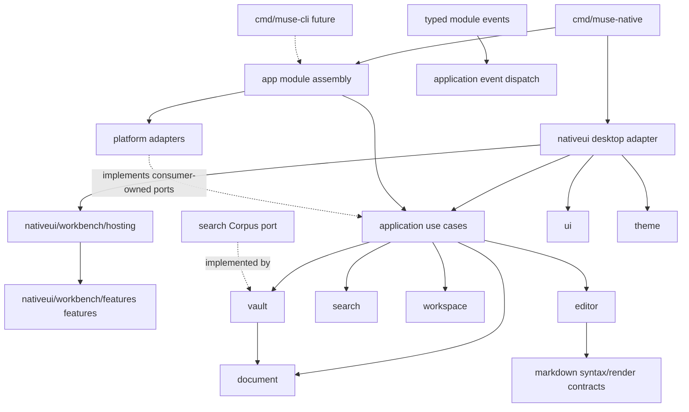

# Muse native architecture contract

Status: target architecture for the modular-monolith refactor. This document is the acceptance baseline for package moves and code wiring. If implementation disagrees with this contract, either change the implementation or record an explicit architecture decision here before continuing; do not silently preserve transitional structure.

## Goals

- Keep one native Go module and one desktop application while making feature ownership and dependency direction explicit.
- Allow roadmap features to add behavior through stable, typed module APIs rather than expanding `nativeui.App` or reaching into another module's internals.
- Keep document editing and Markdown rendering fast: avoid copies across package APIs, avoid per-frame global events, and keep caches/resource lifetimes with their owning feature.
- Complete the migration in one target architecture. Compatibility packages, duplicate implementations, old import paths, and temporary forwarding layers are not an acceptable end state.

## Reference basis

The UI architecture uses VS Code Workbench's separation between shell/core and feature-owned code as a structural reference. The stated 75% is an explicit 9-of-12 mapping of relevant source rules below, not a claim of source-code or visual similarity. It replaces the previous mixed `panels` / `surfaces` / `components` top-level taxonomy. Muse uses `workbench/features/<feature>` because these are ordinary first-party application modules; it does not adopt VS Code's contribution/extension registration model, dynamic extension host, Electron process model, or decorator-based service injection.

The remaining references are deliberately limited by concern:

- Joplin informs the separation between user-facing frontends and shared application services/models/storage, including reuse by desktop, mobile, and CLI. Muse's `application`, domain modules, and `platform` adapters own those layers.
- CodeMirror and ProseMirror inform the editor's internal state, view, command, and transaction boundaries. They do not define the overall NativeUI tree.
- GoRex informs MyGo-specific tab, split, pane-focus, and layout behavior. Its package layout is not copied wholesale.
- Anytype and Logseq are note-product comparisons for block presentation and document/UI state coordination. Anytype's published desktop source guide describes global `component`, `lib`, `store`, `model`, and `interface` areas with MobX stores and a gRPC middleware boundary; Logseq describes feature/function-oriented frontend code with document state in DataScript and UI state in atoms. These are useful product-specific examples, but they do not provide the same feature-boundary model as the primary reference. Anytype's desktop repository identifies its license as Any Source Available License 1.0.

The resulting NativeUI rule is: the root package is the composition root; `workbench` owns shell composition, generic pane-host contracts, workspace presentation, command and focus contracts, and shared UI lifecycle; `workbench/features/<feature>` owns each feature's UI state, views, actions, and narrow application adapters. A feature may contain a panel, pane surface, dialog, or more than one of these; those are roles inside the feature, not competing top-level package taxonomies. `components` is reserved for small, genuinely reusable visual primitives. Feature packages expose a narrow public API and do not exchange private state. Workbench core does not import feature implementations; the composition root wires them explicitly. There is no generic service locator, contribution registry, or dynamic plugin loader in this refactor.

### VS Code rule-to-package mapping

The source of the primary reference is Microsoft's published [source organization contract](https://github.com/microsoft/vscode/wiki/Source-Code-Organization/1a0b37e98b7c941127d4482f7ab8f51f95b15eeb), backed by the repository's [layer/contribution instructions](https://github.com/microsoft/vscode/blob/main/.github/instructions/source-code-organization.instructions.md). For a reproducible comparison, this table enumerates twelve relevant structural properties from those documents. Nine are adopted or translated to Muse's runtime; three are deliberately omitted, giving the approximate 9/12 (75%) figure.

| VS Code source structure/rule | Muse target | Treatment |
|---|---|---|
| `src/vs/base` and `src/vs/platform` separate general UI building blocks from shared platform services | `ui` and `platform` | Adopt: toolkit-neutral primitives and OS/runtime implementations stay below NativeUI |
| `src/vs/editor` is independent of Electron/Node runtime layers | `editor` and `markdown` | Adopt: editing and Markdown models remain independent of MyGo presentation |
| `src/vs/workbench` is the application workbench layer | `nativeui/workbench` | Adopt: shared shell, pane-host contracts, commands, focus routing and workspace projection live here |
| `src/vs/workbench/services` contains workbench-wide services | `nativeui/workbench/hosting`, `commands`, `focus` | Adapt: only genuinely cross-feature UI services belong here; feature-only services remain with their feature |
| `src/vs/workbench/contrib/<feature>` groups feature-owned implementations | `nativeui/workbench/features/<feature>` | Adapt the ownership boundary; Muse uses ordinary feature packages and explicit composition, not VS Code contribution registration |
| Feature APIs limit cross-feature reach-through | `<feature>/api.go` where another feature needs a stable seam | Adopt the boundary principle; expose APIs only when there is a real consumer |
| Code outside a feature cannot depend on its private internals | Workbench core imports no feature packages | Adopt directly |
| Features do not reach into another feature's internals | Cross-feature access through a narrow API or application use case | Adopt directly |
| Feature-only services stay feature-local | Feature-local constructors and dependencies | Adopt the ownership principle; no global service locator |
| Runtime-specific `common/browser/electron-*` package split | No corresponding package split | Omit: Muse has one MyGo native UI runtime, with OS-specific code in `platform` |
| Dynamic VS Code extension host/contribution ecosystem | No dynamic loader in this refactor | Omit: features are statically linked; a plugin runtime is a separate future capability |
| Decorator/service-identifier dependency injection | Explicit Go constructors and typed ports | Omit the mechanism; retain constructor injection without a global container |

The nine adopted/adapted rows define the approximate 75% reference correspondence; the last three state explicit non-correspondences. This ratio is a review aid for architecture choices, not a universal mathematical measure of codebase similarity.

### `hosting` and interaction responsibilities

Neither `hosting` nor a generic `interactions` package is a one-to-one VS Code package mapping. VS Code separates editor opening/activation (`IEditorService`), editor groups (`IEditorGroupsService`), editor-area presentation (`EditorPart`), and view placement (`ViewsService`). Muse's `workbench/hosting` is a Muse-specific adapter seam that unifies only the live pane/window slot contract needed by its generic pane manager; it owns stable host handles, placement, focus ownership and lifecycle, and must not own a feature's view state. Durable tabs/splits remain in `workspace`; MyGo layout translation remains in `workbench/workspace`; feature content and its transient state remain in `features/<feature>`. GoRex is a behavioral analogue for tab/split/pane state and presentation, but keeps these responsibilities in its app package rather than defining a generic host package; its `host.go` is specifically a machine-information popover.

`interactions` is intentionally not a package in the target tree. VS Code does not group all input behavior under such an umbrella: command registration/dispatch and keybinding resolution are separate infrastructure, context keys expose enablement/focus state, and feature-specific handlers live with their features. Muse follows that division: shared command contracts/dispatch go in `workbench/commands`, ordered panel-focus movement goes in `workbench/focus`, pane focus ownership goes in `workbench/hosting`, and feature-specific pointer/key/drag behavior stays with its feature. A shared drag/drop protocol would warrant a package only after multiple features demonstrably share that contract; it is not a generic interactions bucket.

`workbench/focus` owns ordered panel focus movement. `workbench/context` is a separate, deliberately small UI-condition model inspired by VS Code's context-key expressions and Zed's nested key contexts. A context scope contributes facts; a resolved immutable snapshot overlays scopes from workspace to pane to focused control, with the nearest scope winning. Features own and name their keys (for example `explorer.hasSelection`, `editor.mode`, `search.open`); the shared package owns typed key/value access, snapshot composition, and pure rules (`equals`, `not`, `all`, `any`).

Commands and keybindings may reference the same pure rule so menus, enablement, and input routing agree. Evaluating a rule is side-effect free; dispatch still checks availability before running the action. Action-specific arguments remain separate from context facts. Start with typed in-process keys and rules; add a text parser, user-configurable context names, change-event bus, or dynamic registration only when a product feature needs them. This is not Go's `context.Context`, an application state store, or a replacement for domain rules. `focus` produces/updates focus facts, `hosting` performs native focus transitions, and feature-owned state produces its own context facts.

### Complementary references and exact scope

| Reference | Source structure or rule | Muse mapping |
|---|---|---|
| Joplin | [Frontend is separate from shared services, models, and database; desktop/mobile/CLI use the shared backend](https://joplinapp.org/help/dev/spec/architecture/) | `nativeui` calls `application` and domain APIs; `cmd/muse-cli` can use the same application layer without NativeUI |
| CodeMirror / ProseMirror | [State and view are separate](https://codemirror.net/docs/guide/); [model, state, view, and transform are separate packages](https://prosemirror.net/docs/guide/) | `editor` owns session/transactions/commands; `nativeui/workbench/features/editor` owns MyGo presentation and host adaptation |
| GoRex | [`state.go` owns tabs/split/persistence; `view.go`, `tabs.go`, and `commands.go` present pane behavior](https://github.com/egoist/gorex); `host.go` is the machine-information popover, not a generic pane host | `workspace` and `nativeui/workbench/workspace` follow its state/presentation split; Muse's `workbench/hosting` has no direct GoRex package counterpart |
| Zed | [Active key contexts form a Workspace → Pane/Panel → Editor tree with boolean and ancestor-match expressions](https://zed.dev/docs/key-bindings#contexts); [GPUI attaches actions and key contexts to element subtrees](https://github.com/zed-industries/zed/blob/main/crates/gpui/docs/key_dispatch.md) | Use scoped context composition and context-aware action resolution as the reference for `workbench/context`; do not copy GPUI's Rust entity/context runtime |
| Anytype | [Published frontend layout separates `component`, `lib`, `store`, `model`, and `interface`](https://github.com/anyproto/anytype-ts/blob/develop/docs/src/ts/README.md); [gRPC API is the frontend/middleware boundary](https://github.com/anyproto/anytype-ts/blob/develop/docs/src/ts/lib/api/README.md) | Compare block/document presentation and API boundary only; do not copy the global technical-category tree. The client identifies itself as open code under ASAL 1.0. |
| Logseq | [Frontend components/handlers/workers and document DB vs UI state](https://github.com/logseq/logseq/blob/master/CODEBASE_OVERVIEW.md) | Compare document/UI state coordination and worker ownership; it does not define Muse's NativeUI feature boundary |

## Target package tree

```text
native/
├── app/                           # composition root and module lifetime
├── cmd/muse-native/               # thin executable entry point
├── cmd/mdshot/                    # Markdown rendering inspection utility
├── cmd/searchbench/               # search benchmark utility
├── application/                   # cross-module user use cases
│   ├── agent/                     # agent session and tool workflows
│   ├── document/                  # open/save/export note workflows
│   ├── config/                    # typed settings persistence port
│   ├── vault/                     # open/switch/refresh vault workflows
│   └── workspace/                 # restore and persist session workflows
├── events/                        # minimal typed in-process event contract
├── document/                      # durable note model and policies
│   ├── date/                      # note date parsing and normalization
│   ├── frontmatter/
│   ├── repository.go              # note/recovery ports and domain errors
│   └── types/                     # stable value types only
├── vault/                         # vault identity and note relationships
│   ├── files/                     # discovery/catalog
│   ├── index/                     # note metadata and parsed structure projections
│   ├── links/                     # resolution/backlinks
│   └── watch/                     # watcher lifecycle and vault event policy
├── search/                        # query domain and search execution
│   ├── query/                     # syntax, AST, validation
│   ├── fields/                    # type/tags/time semantics
│   ├── plan/                      # query compilation/execution
│   ├── rank/                      # scoring and time-aware ranking
│   └── quickopen/                 # path/title/alias candidate matching and ranking
├── workspace/                     # tabs, active view, layout and restoration
├── editor/                        # public editing-session facade and composition
│   ├── input/                     # keymap, Vim modes and command interpretation
│   │   └── vim/                   # Vim mode state machine, prefixes and command mapping
│   ├── navigation/                # source-position movement and structural navigation
│   ├── findreplace/                # current-buffer match ranges and source replacement operations
│   ├── source/                    # editor source/revision bridge to Markdown syntax
│   ├── layout/                    # editor block geometry and virtualized layout policy
│   ├── blocks/
│   │   ├── inline/
│   │   ├── paragraph/
│   │   └── table/                 # table editing subsystem
│   └── internal/
│       └── core/                  # editor-private buffer/transaction primitives
├── markdown/                      # public Markdown parse/render facade
│   ├── syntax/
│   ├── render/
│   ├── images/
│   ├── math/
│   │   └── texcanvas/             # native canvas integration for TeX rendering
│   └── diagrams/
├── agent/                         # provider-neutral conversation and tool value model
├── config/                        # serialized settings, defaults and migration
├── theme/                         # runtime palette and visual tokens
├── ui/                            # reusable UI primitives
│   ├── scrollbar/
│   └── iconlibrary/
├── nativeui/                      # static UI composition root; no feature policy or duplicate feature state
│   ├── workbench/
│       ├── shell/                 # app chrome and overall workbench layout
│       ├── hosting/               # Muse-specific live pane host contract, focus and lifecycle
│       ├── workspace/             # MyGo projection of tabs/split tree to hosted pane slots
│       ├── commands/              # typed command registration/dispatch contracts
│       ├── context/               # scoped UI facts and composable command conditions
│       ├── focus/                 # ordered panel focus movement, independent of toolkit handles
│       ├── keybindings/           # platform-neutral key strokes and sequence matching
│       ├── dragdrop/              # typed payloads shared across feature modules
│       ├── diagnostics/           # opt-in runtime and resource diagnostics
│       └── features/              # first-party feature-owned UI modules
│           ├── editor/            # note editor surface and its UI-specific subsystems
│           ├── explorer/          # file tree and vault navigation view
│           ├── vault/             # UI coordination for vault lifecycle and refresh
│           ├── outline/
│           ├── search/            # workspace search and current-document find/replace views
│           ├── quickopen/         # transient file chooser surface; matching stays in search/quickopen
│           ├── backlinks/
│           ├── imagedocument/     # image opened as a workspace document
│           ├── imagepreview/      # transient image preview pane
│           ├── mermaidpreview/    # transient Mermaid preview pane
│           ├── linkpreview/       # transient wiki/link preview
│           ├── properties/
│           ├── commandpalette/
│           ├── settings/
│           ├── agent/
│           └── dialogs/           # feature-owned or shared dialog presentations
│               ├── document/      # conflict, recovery, and metadata migration dialogs
│               └── export_adapter.go
│   └── components/                # only low-level, cross-feature visual primitives
├── platform/                      # OS/runtime adapters
│   ├── agent/                      # external AI provider HTTP adapters and wire protocol
│   ├── externalopener/            # open URLs/files with the host system
│   ├── cachepath/                  # OS/XDG cache-root policy
│   ├── process/
│   │   └── vaultsearchindexer/    # indexer process reconciliation/lifecycle
│   └── filesystem/
│       ├── documentstore/         # concrete note/recovery persistence
│       ├── configstore/           # user settings JSON files and config-root policy
│       ├── imagecache/            # atomic image cache persistence
│       ├── temporaryimages/       # temporary image files for unsaved documents
│       ├── exportstore/           # exported document writing
│       ├── filemetadata/          # platform file metadata reads
│       ├── imagefiles/            # image source file access
│       ├── naviconstore/          # concrete per-vault icon preference persistence
│       ├── recentstore/           # concrete recent-document persistence
│       ├── vaultfiles/             # concrete vault file operations
│       ├── vaultindexsource/      # concrete recursive source for vault indexing
│       ├── vaultfilessource/      # concrete source for vault catalog discovery
│       ├── vaultsearchstore/      # concrete persistent search-index storage
│       ├── workspacestore/        # concrete workspace snapshot persistence
│       └── watcher/               # concrete filesystem watcher
└── locales/                       # localization data and generated catalog
```

Each feature is a regular Go package. The composition root wires the feature explicitly; it may expose a narrow API when other modules need one. Its internal organization follows the feature's needs, for example:

```text
nativeui/workbench/features/editor/
├── surface/            # one editor instance hosted in a workspace pane
├── inputadapter/       # MyGo event adaptation and host-side input routing
│   └── vim/             # Vim-specific host and prompt adapters
├── navigation/         # editor-host navigation integration
├── ime/                # text composition and IME host lifecycle
├── session/            # transaction and history integration
├── render/             # rich-text projection and MyGo painting
├── blocks/             # inline, paragraph, table, and media UI adapters
├── navigationrail/     # heading rail presentation
├── textlayout/         # MyGo-backed shaping and layout cache
├── settings/           # editor-specific settings projection
└── feedback/           # transient cursor/search/yank visuals
```

The role is not to force every feature into the same subdirectory template. The invariant is ownership: a feature keeps its state, UI, commands, and feature-only services together; a narrow API is added when needed. Shared workbench code may define host contracts, but it may not import feature implementations.

| Existing NativeUI area | Target feature/core owner |
|---|---|
| `panels/filetree`, `filetree_panel.go`, and tree-local state in `app.go` | `workbench/features/explorer` |
| `panels/outline` | `workbench/features/outline` |
| `panels/search` and `panels/findreplace` | `workbench/features/search` (query and replacement semantics stay in `search` / `editor/findreplace`) |
| `surfaces/noteeditor` and `components/editor` | `workbench/features/editor` |
| `surfaces/quickopen` | `workbench/features/quickopen` (candidate matching remains in `search/quickopen`) |
| `surfaces/backlinks` | `workbench/features/backlinks` (resolution remains in `vault/links`) |
| `surfaces/imagepreview`, `surfaces/imagedocument`, `surfaces/mermaidpreview` | Separate `workbench/features/imagepreview`, `imagedocument`, and `mermaidpreview` features |
| `panels/properties`, `panels/commandpalette`, `panels/settings`, `panels/agent`, `panels/naviconpicker`, `panels/vaulthome` | Corresponding feature modules; shared settings/vault policy stays in its owning application/domain module |
| `components/markdown`, `components/linkpreview` | `workbench/features/markdown`, `workbench/features/linkpreview` |
| `window`, `workspacepresenter` | `workbench/hosting` for live pane contracts; `workbench/workspace` for MyGo layout projection |
| `components/doctypes` | `document/types` for document-kind policy; UI-specific renderer selection remains in the owning feature |
| `components/icons`, `components/windowcontrols` | `components/icons`, `workbench/shell/windowcontrols` |

The child entries in this tree are real Go package boundaries, not merely folders used to group files. `editor` and `markdown` are public facades; they should compose focused subsystems rather than retain the current large implementation bodies. A subsystem may stay in its parent package only when it shares private invariants that cannot yet be expressed through a narrow typed contract. Do not create one-file packages or empty forwarding shells just to match the tree.

### Editor extraction map

`native/editor` is not intended to stay flat. The current files are large and some mix policy with MyGo rendering, so migration must split by responsibility rather than move each file wholesale. The main groups are:

| Target package | Responsibility | Current flat-file families to inspect and split |
|---|---|---|
| `editor` facade | Public `Session`, neutral input/transaction/frame types, and composition only | Keep the public API small (`api.go`, `session.go`); do not leave the current `Editor` view implementation as the production facade |
| `editor/internal/core` | Buffer, selection, undo/history, source transactions, system patches | Core portions of `editor.go`, `edit.go`, `transaction.go`, `history.go`, `operations.go`, `multirange.go`, and `system_patch.go` |
| `editor/source` | Incremental synchronization from editor source revisions to the Markdown syntax parser, including editor-only comment/frontmatter masking and source-offset preservation | `parsed.go`, `mask.go`, and parser-source tests |
| `editor/input` | Toolkit-neutral key/text event and operation contracts shared by keymaps | `event.go`, `key_event.go`, `operation.go`, and `sequence.go` |
| `editor/input/vim` | Independent Vim mode state machine, pending prefixes/counts/registers, and mapping from neutral key/text events to typed intents | `modal.go`, Vim-specific command interpretation, and mode/sequence tests; expose a narrow Host contract for editor effects |
| `editor/navigation` | Source-position movement, grapheme boundaries, and structural navigation policy | `nav.go`, `comment_nav.go`, `editor_grapheme.go`, and movement policy currently mixed into Vim/navigation files |
| `editor/findreplace` | Case-insensitive current-buffer matching, source ranges and safe single/all replacement planning | Current-document `findHits`, snippet/range generation, and replacement planning in `nativeui.App` |
| `editor/layout` | Backend-neutral block and viewport geometry, visible-range indexing, virtualization, and scrolling policy | Geometry and virtualization portions of `layout.go`; horizontal offset/reveal/bar geometry and virtual-row policy from `horizontal_scroll.go` and `vim_virtual_image_rows.go` |
| `editor/blocks/inline` | Inline formatting, pair insertion/skip rules, math editing state, wiki/tag/comment behavior | Semantic portions of `format.go`, `inlinemath.go`, `wikilink.go`, `tag.go`, and `comment.go`; auto-pair and closer-skip policy from `nativeui/workbench/features/editor/editor_edit.go` |
| `editor/blocks/paragraph` | Heading/list/fold/break behavior, typed block shortcuts, and paragraph transactions | `folding.go`, `typed_breaks.go`, `paragraph`/heading/list portions of editor commands; fenced-code/math shortcut construction from `nativeui/workbench/features/editor/editor_edit.go` |
| `editor/blocks/table` | Table selection model, hit testing, grid geometry, and row/column operations | Semantic portions of `table_document_selection.go`, `table_region_*.go`, `table_virtual_edit.go`, and `table_visual_modes.go` |
| `nativeui/workbench/features/editor` | MyGo input/render adapter, editing interaction orchestration, IME, painting, scroll event translation, and block-specific UI | MyGo-dependent portions of `view.go`, `display.go`, `paint.go`, `ime.go`, `rectangle.go`, `assets.go`, `source_highlight.go`, `image_controls.go`, `table_*_ui.go`, `table_edges.go`, `table_cell_menu.go`, and `table_reorder.go`; host scroll input/indicator adapters |

The table entries are responsibility guides, not mechanical move lists: files that combine model behavior and UI must be split before their owners change. Tests move with the package that owns the tested behavior; Vim mode/command tests belong with `editor/input/vim`, movement semantics belong with `editor/navigation`, UI/input adapter tests belong with the component adapter, and transaction tests stay with the core. A package is justified when it has a coherent contract and more than a forwarding file.

An `_adapter.go` filename does not itself establish a module boundary. Keep an adapter when it translates between a consumer-owned contract and a concrete toolkit, operating-system, or host capability. The adapter should have one clear direction and no duplicate feature state. A `*Editor` receiver that reads private state may stay in the component root as a narrow host bridge, but rendering policy and feature behavior stay with their owning package. Forward-only compatibility shims and duplicate implementations are migration leftovers and must be removed before completion.

Vim remains a selectable editor input strategy, not a second editor core. Its state machine owns mode transitions, command prefixes/counts, register selection, and key-to-intent mapping. It sends typed intents through a narrow Host callback; the host resolves source/selection context and dispatches editor operations without exposing `Editor` fields or buffer/history to Vim. `editor/navigation` implements movement semantics, `editor/blocks/*` implements block operations, and `editor/internal/core` commits edits. The UI adapter translates MyGo events to neutral input events and renders the current mode label/command prompt from an immutable Vim view state.

Text shaping needs an explicit backend boundary. `editor/layout` owns neutral block, viewport, scrolling, and virtualization policy. MyGo scroll event translation and indicator lifecycle stay in the editor feature host. The current shaping implementation imports MyGo and therefore belongs under `nativeui/workbench/features/editor/textlayout`; it must not stay under `editor` or `editor/internal`. If a backend-neutral shaping algorithm is extracted later, it can live behind that feature package's narrow input/output contract without depending on MyGo.

The editor source adapter does not duplicate Markdown grammar or AST ownership. `editor/source` coordinates the editor's incremental source/revision and masking needs, then delegates Markdown syntax parsing and AST updates to `markdown/syntax`; it may not define a second Markdown AST or parser grammar. This is a public editor subsystem package, rather than an `internal` package, because `nativeui/workbench/features/editor` must be able to consume it without violating Go's `internal` import boundary.

`editor.Session.Frame` is a neutral source snapshot containing only revision, source text, and selection. It must not carry a Markdown AST, rendered block tree, toolkit object, or cache. `editor/source` owns the source-to-syntax projection; Markdown parsing and render models remain in `markdown`. `nativeui/workbench/features/editor` may keep a separate immutable viewport frame containing only visible UI blocks and presentation resources.

`editor/blocks/*` owns the behavior and session state of each block subsystem; table syntax and parsed structure remain in Markdown, while table selection and edits belong to `editor/blocks/table` and table painting/input belongs to the editor UI component. Rich-text input rules such as auto-pairing, Markdown block shortcuts, list continuation, structural Enter/Backspace behavior, and semantic table selection are editor policy, not UI behavior. UI adapters may inspect parser-projected geometry and translate toolkit events, but must ask the owning editor or block subsystem for the resulting operation/transaction.

### Editor UI component extraction map

`nativeui/workbench/features/editor` is also too large to remain a single flat package. Its current `Editor` shares private leaf, view-cache, session, and interaction state across input, layout, display, and paint. In the layout phase, place files under the target responsibility directories without changing their bodies; these paths are only a skeleton and are not usable package boundaries yet. In the later wiring phase, split mixed implementations and introduce narrow immutable frames or typed host interfaces before changing package declarations and imports.

| Target package | Owns | Candidate current files / required seam |
|---|---|---|
| `workbench/features/editor` | Editor host, construction, lifecycle, scroll event translation, and narrow host bridges for child components | Keep the host lifecycle, MyGo scroll input/indicator handling, orchestration, and methods that must read private `Editor` state to implement child-owned capabilities; keep feature view/state/policy in child packages and do not export broad mutable state |
| `workbench/features/editor/session` | Applying a validated editor transaction through the authoritative domain session | `transaction.go` accepts a domain `Session` and value transaction; parser synchronization and feature-owned history snapshots stay in the feature host because they require private presentation state |
| `workbench/features/editor/input` | Pure MyGo key/text normalization into `editor/input` values | `key_event.go`; keymap interpretation and stateful `Editor` dispatch stay with their owners, while the Vim prompt view consumes a narrow presentation host |
| `workbench/features/editor/ime` | MyGo text-composition lifecycle, UTF-16 range conversion, and text-input client contract | `client.go`, `state.go`, and `index.go`; the feature-root IME host implements narrow source-edit and geometry capabilities |
| `workbench/features/editor/blocks/inline` | Inline-link suggestion/hover UI and host-side inline actions | Move wiki suggestion popup state and link interaction adapters here; consume `editor/blocks/inline` source ranges and typed actions |
| `workbench/features/editor/blocks/inline` | Inline formatting command adapter over the source-level inline subsystem | `editor_format.go`; keep delimiter/range policy in `editor/blocks/inline` and limit the feature adapter to host facts and applying returned edits |
| `workbench/features/editor/blocks/paragraph` | Fold affordances, fold host state, and paragraph-specific interactions | `folding_host.go` and `typed_breaks_host.go` with fold-chevron and typed-break UI adapters; heading/source policies remain in `editor/blocks/paragraph` |
| `workbench/features/editor/blocks/table` | Table-only menus, drag/resize affordances, selection projection, and presentation/input adapters | `table_cell_menu.go`, `table_edges.go`, `table_reorder.go`, `document_selection_adapter.go`, and the UI part of `table_host.go`; consume `editor/blocks/table` state through a typed host |
| `workbench/features/editor/blocks/media` | Image, math, and diagram controls/presentation and UI resource lifetime | `image_controls.go`, `math_preview.go`, and `diagram_preview.go`; resolve leaf/source access through a typed media host |
| `workbench/features/editor/render` | MyGo painting, rich-text block projection, syntax-token styling, and view composition from an immutable visible-block frame | `document.go`, `paint.go`, `display.go`, `production_view.go`, `production_layout_host.go`, `source_reveal.go`, `source_highlight.go`, HTML/callout/wiki-embed presentation; object projection/painter invariant tests such as `object_size_test.go`. Keep tests coupled to the editor host in the feature root until the renderer contract is wired. |
| `workbench/features/editor/navigation` | Reusable visible-text/source coordinate mapping with no editor or toolkit state | `mapping.go`; editor movement and layout-aware host resolution stay in the feature host and delegate source-position policy to `editor/navigation` |
| `workbench/features/editor/navigationrail` | Heading-rail rendering, hover/preview presentation, and interaction state | `view.go` and `policy.go`; it consumes an immutable heading frame and typed preview/jump callbacks, never an `Editor` or source model |
| `workbench/features/editor/feedback` | Transient visual feedback and animation state | `smooth_cursor.go`, `search_match_pulse.go`, `vim_yank_flash.go`; keep source selection and movement authoritative in `editor` |
| `workbench/features/editor/textlayout` | MyGo-backed shaping and text-layout cache | Existing package; keep it dependent on backend drawing types and independent from editor session policy |

The candidate map records the final owners, not an instruction to change dependencies during the layout pass. During layout-only moves, keep file bodies and package declarations unchanged even when they temporarily depend on the old shared package; the later wiring phase splits mixed implementations and introduces narrow typed contracts. The renderer currently has the widest private-state reach, so its package API will need special care during wiring. Semantic editing behavior remains in `editor`, `editor/navigation`, and `editor/blocks/*`; these UI packages translate host events, supply toolkit facts such as hit-tested source ranges, apply returned transactions through the editor session, and present resulting state. The editor feature's navigation adapter owns display-to-source mapping only; source movement semantics remain in `editor/navigation` and the relevant block subsystem. The feature root produces revision-tagged heading snapshots and passes values plus typed callbacks to the navigation rail, which never receives an `Editor` handle.

`markdown/syntax` owns Markdown parsing and AST values. `markdown/render` maps parsed values to rendered blocks. `images`, `math`, and `diagrams` own their bounded media/rendering pipelines and caches; they expose results to the renderer without depending on the editor session. The root `markdown` package is the stable entry point for common parse/render operations.

For very large Base64 image destinations, the exact Markdown recognition and synthetic inline-token fast path belong to `markdown/syntax`: it must preserve canonical parse token kinds and byte ranges and must not decode image bytes. A source-revision cache belongs with the editor's source projection, while decoding, pixel budgets and decoded-resource caching stay in `markdown/images`; MyGo image placement and controls stay in `nativeui/workbench/features/editor/blocks/media`. Do not let this parser optimization become a second Markdown grammar or a UI-owned syntax rule.

`search/quickopen` owns fuzzy matching across candidate path, title, and aliases, including rank and rune-based highlight positions. `nativeui/workbench/features/quickopen` owns the chooser's transient query/selection view state and presentation; it consumes ranked candidates and returns typed actions. Mermaid parsing and diagram models remain in `markdown`; `nativeui/workbench/features/mermaidpreview` owns transient viewport state and MyGo presentation.

`nativeui/workbench/hosting` owns Muse's generic runtime host contract for windows and panes: stable handles, placement, focus ownership, and content lifecycle. It does not attempt to reproduce VS Code's separate editor-group, editor-area, and view-container services as one implementation, and it never imports a feature package or exposes concrete feature state. `workspace` owns durable tabs, active documents and split descriptors; `nativeui/workbench/workspace` translates them into MyGo layout and emits typed actions. This follows GoRex's observable division of split state from its view/host code, while keeping Muse's durable layout model out of UI packages.

Each package under `nativeui/workbench/features/<feature>` owns the state and presentation for that feature. Add an `api.go` only when another module needs a supported seam. The root `nativeui.App` is the composition root that wires concrete feature implementations. Workbench core depends only on contracts and shared components; it does not import feature implementations. Cross-feature calls use the callee's public API or an application use case, never private state. Feature policy stays in `application`, `vault`, `search`, `document`, `editor`, or `agent`.

The editor feature composes one pane's document workflow and `editor.Session` into hosted content. It owns its editor instance and transient cursor/view state; `workspace` owns portable restore descriptors. The app routes pane commands using `FocusedPane` and typed capabilities rather than retaining parallel editor state. Persisted workspace data contains no widgets, bitmaps, or feature-private state.

Openable document-kind policy belongs in `document/types`, not a UI component package. A feature may expose a renderer through its public API; renderer selection must not make document policy depend on MyGo or Markdown presentation.

### NativeUI root extraction map

The root `nativeui` package is still larger than its target responsibility. Keep App construction, cross-surface routing, and narrow adapters that genuinely coordinate multiple modules there; move feature view state/rendering into the existing panel/surface packages and move business policy into its owning module. Do not use a callback that exposes `*App` as a substitute for a capability boundary.

| Current root files / behavior | Target owner | Root package keeps |
|---|---|---|
| `command_palette.go`: query/selection state and palette rendering | `workbench/features/commandpalette` | Command registration and dispatch to application use cases |
| `vault_home.go`, settings and nav-icon picker rendering/state | `workbench/features/workspace`, `workbench/features/settings`, `workbench/features/naviconpicker` | Injected repositories and application capability adapters |
| `assistant_panel_adapter.go`: assistant panel rendering and tool-policy rules | `workbench/features/agent` for presentation; `agent` / `application/agent` for policy and workflows | Tool capability wiring at composition time |
| `filetree_panel.go`, `file_tree_keys.go`: tree rendering, view state, tree-local commands | `workbench/features/explorer`; shared command and focus contracts in `workbench/commands` and `workbench/focus` | Typed action dispatch to `application/vault` |
| `app.go`: flattened visible tree rows, selection projection and create-target choice coupled to expansion/selection state | `workbench/features/explorer` projection state and typed feature API | Supply catalog child/directory lookups and invalidate after vault catalog changes |
| `app.go`: Markdown heading fragment slug generation | `markdown/syntax` | Resolve the active note heading and navigate its source offset |
| `app.go`: file-extension language selection and rich-Markdown path classification | `workbench/features/editor` for MyGo language IDs; `document/types` for Markdown type policy | Supply the path and use the returned language/parser classification |
| `properties_panel_adapter.go`: property view preferences, parsed-document cache, system-property snapshot and display projection | `workbench/features/properties` | Config repository load/save adapter and typed metadata-workflow dispatch to `application/document` |
| `vault_lifecycle.go`: backlink grouping/resolution and search-result policy | `vault/links`, `search`, and `application/vault` | Watch/index lifecycle coordination and opening the selected document |
| `workspace_search_policy.go`: search scheduling/coalescing | `search` or a focused `application/search` workflow | UI query input and dispatch |
| `app.go`: current-document find/replace query, hit cache, selection, scrolling and rendering | `workbench/features/search` for presentation; `editor/findreplace` for matching/ranges/replacement planning | Route typed actions to the active note editor and apply resulting transactions |
| `file_creation.go` and file-operation branches in `app.go` | `application/vault` for create/move/overwrite/root-boundary policy | Dialog/drop event translation and typed use-case calls |
| `link_preview.go`: hover state/rendering and wiki target resolution | `workbench/features/linkpreview` for presentation; `vault/links` for resolution | Feature registration and resolver injection |
| `migration_adapter.go` and `components/documentdialogs` | `workbench/features/dialogs/document` | Keep migration policy and document workflows in `application/document` |
| `document_header.go` and settings/assistant panel renderers | `workbench/features/editor` or their owning feature module | Composition only |
| `icons.go`, `window_controls.go`, `header_fade.go` | `components/icons` adapts catalog assets; `workbench/shell/windowcontrols` owns native shell buttons; `header_fade.go` belongs to shell presentation | App shell composition |

During the layout phase, move files and tests into the feature modules and workbench packages named above. During wiring, split mixed files, define view snapshots/typed actions/consumer-owned capabilities, and remove direct `*App` dependencies from feature packages. A helper may remain at the root only when it is app assembly or cross-feature orchestration; reading `App` private fields does not turn a feature rule into orchestration. Shell visuals belong in `workbench/shell`; generic pane lifecycle belongs in `workbench/hosting`.

Source-position text navigation belongs to `editor/navigation`; MyGo event translation, focus, painting, text measurement, and viewport geometry stay in `nativeui/workbench/features/editor`. `editor.Session` exposes backend-neutral input intents, transactions, and immutable revision frames. `nativeui/workbench/features/markdown` paints the neutral Markdown model for editor and standalone preview callers. `platform/cachepath` owns OS/XDG cache-root policy, while feature modules receive cache storage through consumer-owned ports. Media decoding/cache policy remains with the feature that owns it, and concrete filesystem access remains in platform adapters.

## Ownership and model boundaries

| Module | Owns | Must not own |
|---|---|---|
| `document` | Durable `Note` path identity, metadata, source/revision semantics, save/conflict/recovery policies | Cursor, selection, focus, scroll, widgets, parsed render nodes |
| `editor` | Mutable `Buffer`, edit transactions, undo/redo, selection, input mode, navigation and block editing | Vault indexing, persistence implementation, durable note identity, OS APIs |
| `markdown` | Markdown syntax/AST and derived rendering structures for inline, paragraph, table, image, math and diagrams | Durable note aggregate, editor selection/commands, application panel state |
| `vault` | Vault identity, file catalog, index lifecycle, link resolution/backlinks and watcher-to-vault policy | Search query language/ranking, native UI, document editing buffer |
| `search` | Query language/AST, field/operator meaning, execution plan, ranking and result contract | Filesystem traversal, concrete vault index layout, panel state |
| `workspace` | Open documents, active view, tabs/panes/layout, restoration snapshot and repository contract | Note source of truth, editor implementation internals, filesystem persistence |
| `application` | User workflows spanning modules, ordering, cancellation and transaction boundaries | Domain invariants that belong to a feature module |
| `agent` | Provider-neutral conversation messages, parts, tool requests/results and their stable value semantics | Session lifecycle, permissions/workflow policy, provider HTTP protocol, UI state |
| `application/agent` | Conversation session lifecycle, streaming/approval orchestration, tool permissions and consumer-owned provider capabilities | Conversation value semantics, provider wire formats, panel state |
| `nativeui` | Rendering, input translation, focus/panel state and calling use cases | Business rules, storage/index implementation, query execution |
| `config` / `theme` | Persisted settings schema vs derived runtime style values | Editor/document policy or interaction state machines |
| `ui` | Backend-neutral reusable UI behavior/components | Muse business concepts or platform-specific APIs |
| `platform` | OS/runtime implementations for dialogs, clipboard, filesystem, cache paths and resource access | Feature policy or view composition |

The current persistence model uses the normalized note path as identity. The repository does not persist a separate stable note ID or vault ID. Renaming or moving a note is therefore a delete plus create; do not synthesize a path hash and describe it as a stable identity. `document.Note` carries the current path, source, parsed metadata and disk revision. A future stable-ID migration must introduce persisted identity before changing this contract.

There are three separate representations of a note:

1. `document.Note` is the durable path-identified domain record and source/revision boundary.
2. `editor.Buffer` is the active mutable editing session and commits source changes as transactions.
3. `markdown`'s syntax/render tree is derived from a source revision and may be rebuilt or incrementally updated.

They must not be merged into one state object. Table syntax belongs to `markdown`; cell selection, hit testing, grid geometry and row/column commands belong to `editor/blocks/table`. Table edits commit through normal editor transactions. Fold/view mode is session state and is persisted by `workspace` only if restart restoration promises it.

## Dependency rules



- Domain packages do not import `nativeui`, MyGo widget packages, `platform`, or executable packages.
- `markdown` never imports `editor`; editor consumes parsed structures and owns edits.
- `search` owns the corpus/query contracts; `vault/index` implements the corpus contract without exposing its storage layout. `vault/index` also projects parsed link structure through an immutable narrow contract; `vault/links` owns path/title/alias resolution, outgoing links, backlinks, and their derived caches.
- Ports are declared by the module/use case that needs the capability. `document` owns note/recovery repository contracts and domain errors; `platform/filesystem/documentstore` implements them. `workspace` owns its snapshot repository contract; `platform/filesystem/workspacestore` implements it. `application/config` owns the typed user-configuration persistence port; `config` owns schemas, defaults, validation and pure JSON value conversion, while `platform/filesystem/configstore` resolves OS configuration paths and persists the JSON files. Concrete filesystem, dialogs, clipboard, clock, image/font access and persistence implementations live in adapters.
- `app` is the only composition root that selects concrete implementations and wires first-party feature modules.
- `nativeui/workbench/hosting` owns Muse's live window/pane host contract; `workspace` owns the portable descriptors that can be restored. Feature modules keep their state private behind opaque handles.
- No cycles, package-level mutable service locator, or broad `common`, `model`, `strategy`, or `utils` packages.

## Future capability seams

The target should make later capabilities fit through existing module APIs without implementing them in this refactor:

| Future capability | Existing seam | Boundary to preserve |
|---|---|---|
| First-party and third-party extensions | Feature-owned typed APIs, wired by `app` | Keep extension contracts in public feature APIs; never expose `internal` packages, `nativeui.App`, filesystem paths, or global service locators as plugin APIs. Add dynamic loading, permissions and compatibility/version negotiation only when an actual plugin runtime is in scope. |
| CRDT-backed collaboration with Markdown files retained as the durable format | `editor` transactions, `document.Repository`, and application save/session workflows | Keep CRDT state out of widgets and filesystem adapters. Treat the current path identity and disk revision as today's storage contract, not as a permanent collaboration identity or CRDT version. A future stable document ID and change/revision contract must be introduced deliberately; materialized Markdown remains an adapter concern. |
| Headless operation | `application` use cases and domain models have no UI or MyGo dependency | Use cases must be callable without creating a window, UI event loop, or desktop singleton. Background work and lifetimes must be explicit and cancellable. |
| CLI | Separate command adapter over the same application APIs and ports | A CLI command should parse arguments, call application use cases, and format results. It must not invoke nativeui rendering or duplicate vault/search/document rules. Keep the desktop executable similarly thin. |
| Generic window and pane hosting | `nativeui/workbench/hosting` contract plus feature-owned content factories | The host exposes IDs, descriptors, placement, focus and lifecycle only. It must not leak concrete state such as image preview zoom/bitmap state; the owning feature keeps typed state private. Durable workspace snapshots store portable descriptors, not renderer objects. |

`app` assembles feature modules and platform capabilities; command packages select the runtime surface. The native desktop command connects that module assembly to `nativeui`. A future CLI command connects it to terminal input/output. If launching a headless workflow requires constructing a MyGo window or importing `nativeui`, the composition boundary has drifted and must be corrected before adding the CLI.

For plugin readiness, prefer several narrow registries owned by their feature (for example search fields/operators/scorers, document-type metadata, and editor block capabilities). Validate duplicate IDs, dependencies and lifecycle ordering during assembly. These contracts are extension points for Muse modules first; they do not imply a dynamic plugin loader or a universal event/hook framework.

For collaboration readiness, keep source materialization, document identity, and revision semantics separate in the model. The current implementation deliberately identifies notes by normalized path and uses a disk revision for conflict detection. Do not retrofit a path hash as a stable ID or reinterpret a file revision as a CRDT clock. When collaboration becomes active work, add its identity and transaction/sync contract at the document/application boundary while preserving the file adapter's Markdown compatibility.

Headless and CLI readiness also constrains initialization: feature packages must not perform I/O or start goroutines from package initializers. `app` owns construction and shutdown; a command owns its signal handling and output loop, and may omit UI-only services entirely.

## Extension and lifecycle contracts

- `search` supports explicit typed field/operator/scorer registrations. Query parsing produces a validated AST; planning compiles it before execution. Metadata source belongs to `document`/`vault`; query semantics and ranking belong to `search`.
- `editor` block capabilities are explicit and typed. Block operations produce editor transactions; table selection/view state is scoped to its editor session.
- Registration IDs are unique and validated at application assembly. Do not add runtime plugin loading or a universal feature registry until an actual third-party extension requirement exists.
- Domain event types are owned by the module that changes state (`document.DocumentSaved{Path, Revision}`, `workspace.WorkspaceRestored`). The application dispatches them to independent consumers; add a vault event only when a real independent subscriber needs one. Never publish per keystroke.
- Direct calls remain the default for a single workflow. Events are for independent subscribers; hooks are only for deliberate synchronous customization (e.g. a scorer or query operator).
- Coalesce editor changes by transaction/revision. Never broadcast per-frame layout, pointer movement, or every keystroke to a global bus.
- `app` owns process start/stop. Modules take contexts, cancel background work, and release subscriptions/resources when a vault, document session, or workspace closes.

## Completion and acceptance

The refactor is not complete merely because the code compiles. Before closing the goal:

1. Every implementation and test resides under its owning target module; old package directories/import namespaces are gone.
2. Module APIs and dependency direction match this document. UI panels use application/module APIs; no feature reaches through another feature's internals.
3. `nativeui.App` no longer owns document, index, search, or workspace domain state/rules that belong to feature modules.
4. Search, table editing, document save/recovery, workspace restore and Markdown render lifecycles have explicit owners and typed contracts.
5. No migration aliases, duplicate implementations, temporary package shells, stale architecture reference tree, or TODO-based transition path remains.
6. Focused package tests, full native tests, build, and architecture/import-boundary checks pass after all moves and wiring are complete.

## Refactor execution order

Complete one repository-wide target file/package layout pass before further production wiring. Move every implementation and its tests to its final owner directory, remove obsolete source locations, and checkpoint the path-only batches. During this pass, do not change file bodies, package declarations, imports, APIs, or behavior to make the intermediate tree compile; it is expected to be non-compiling until wiring. Do not add new implementations or compatibility aliases. Verify the completed layout against the target tree and confirm moved-file contents are unchanged (renames are path changes, not source additions). Only after every target directory is populated and every obsolete implementation directory is empty may wiring begin. Then wire one module boundary at a time: change package declarations/imports, define the narrow API, integrate its composition, and run the focused checks before moving to the next boundary. Finish with whole-repository build, test, and architecture checks; the layout checkpoint is not a release state.

The NativeUI root intentionally keeps app-composition tests that need `App`'s private state, shared root test helpers, or `TestMain`. Do not move these tests solely to reduce the root file count; moving them into a feature package changes their Go package boundary and is part of wiring/test-seam design, not a path-only layout operation. Likewise, editor-feature root may retain host-coupled integration tests that assert private editor invariants; tests owned by a child subsystem should live with that subsystem.

### Source-size audit

The refactor is intended to reduce duplicated ownership and make shared behavior reusable; package count or directory movement alone is not evidence of that outcome. Record baseline and current Go production/test line counts against the selected `main` commit. Path-only moves must add no source lines. For each wiring batch, classify production-line growth as (a) newly duplicated implementation, (b) required public contract/composition, or (c) behavior actually in scope; remove category (a), and justify each nonzero category (b)/(c) in the batch summary. Do not bulk-copy a former monolithic implementation into a new package while retaining the old copy. The final review must account for the net source-size delta and show that feature ownership has not created duplicate implementations.

Measured during the layout checkpoint: baseline `main` at `c250b054` has 68,289 production Go lines and 38,819 test Go lines (107,108 total); the current dirty worktree has 92,283 production and 49,346 test Go lines (141,629 total), a net increase of 23,994 production and 10,527 test lines. This is a warning to investigate, not an accepted refactor cost. Re-measure after each wiring batch, and explain the baseline-to-final delta by feature; no claim of completion is valid while the production increase remains unaccounted for.

## Architecture decisions during implementation

- 2026-11-16: GoRex is adopted as a behavioral reference for tab/pane focus and split-layout interactions, not as a package architecture to copy. Muse separates durable layout (`workspace`), its adapted live host contract (`nativeui/workbench/hosting`), and toolkit layout presentation (`nativeui/workbench/workspace`). A pane's note/editor composition belongs to `nativeui/workbench/features/editor`; recent pane focus used for runtime close fallback is session policy and is not serialized as durable document content.
- 2026-11-17: Provider-specific HTTP and wire-format code belongs to `platform/agent`; provider-neutral conversation values belong to `agent`, while `application/agent` owns session/permission workflows and the consumer-owned stream/provider ports. The composition root constructs concrete provider adapters and injects their ports. This keeps network protocols and credentials out of UI and application policy.
- 2026-11-16: Refactor execution is layout-first. First relocate implementation and test files to the target package tree without changing package declarations, imports, APIs, or behavior; then perform package/API wiring against that completed tree. The layout-only intermediate may not compile, so do not use build success as its acceptance criterion. The completed wiring phase must remove all migration shells and satisfy the full completion gate above.

Do not weaken these criteria to close the goal. If any criterion remains open, keep the goal active and continue the refactor.
