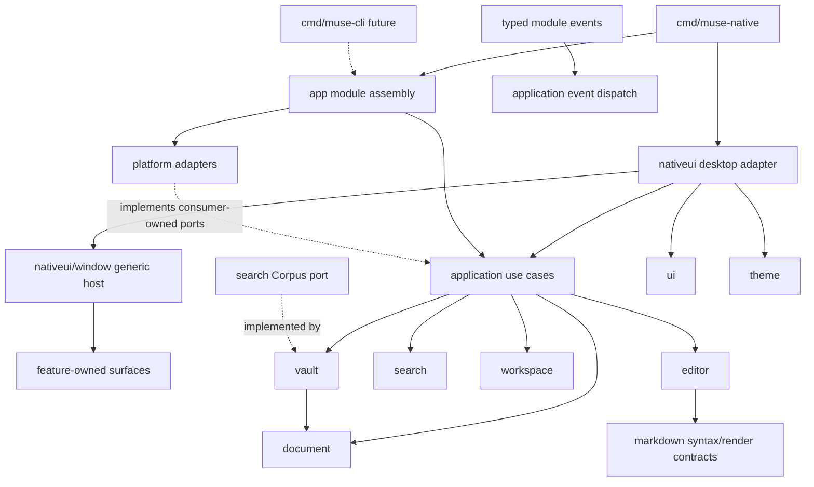

# Muse native architecture contract

Status: target architecture for the modular-monolith refactor. This document is the acceptance baseline for package moves and code wiring. If implementation disagrees with this contract, either change the implementation or record an explicit architecture decision here before continuing; do not silently preserve transitional structure.

## Goals

- Keep one native Go module and one desktop application while making feature ownership and dependency direction explicit.
- Allow roadmap features to add behavior through stable, typed module APIs rather than expanding `nativeui.App` or reaching into another module's internals.
- Keep document editing and Markdown rendering fast: avoid copies across package APIs, avoid per-frame global events, and keep caches/resource lifetimes with their owning feature.
- Complete the migration in one target architecture. Compatibility packages, duplicate implementations, old import paths, and temporary forwarding layers are not an acceptable end state.

## Target package tree

```text
native/
├── app/                           # composition root and module lifetime
├── cmd/muse-native/               # thin executable entry point
├── cmd/mdshot/                    # Markdown rendering inspection utility
├── cmd/searchbench/               # search benchmark utility
├── application/                   # cross-module user use cases
│   ├── agent/                     # agent session and tool workflows
│   ├── document/                  # open/save/export note workflows
│   ├── config/                    # typed settings persistence port
│   ├── vault/                     # open/switch/refresh vault workflows
│   └── workspace/                 # restore and persist session workflows
├── events/                        # minimal typed in-process event contract
├── document/                      # durable note model and policies
│   ├── date/                      # note date parsing and normalization
│   ├── frontmatter/
│   ├── repository.go              # note/recovery ports and domain errors
│   └── types/                     # stable value types only
├── vault/                         # vault identity and note relationships
│   ├── files/                     # discovery/catalog
│   ├── index/                     # note metadata and parsed structure projections
│   ├── links/                     # resolution/backlinks
│   └── watch/                     # watcher lifecycle and vault event policy
├── search/                        # query domain and search execution
│   ├── query/                     # syntax, AST, validation
│   ├── fields/                    # type/tags/time semantics
│   ├── plan/                      # query compilation/execution
│   ├── rank/                      # scoring and time-aware ranking
│   └── quickopen/                 # path/title/alias candidate matching and ranking
├── workspace/                     # tabs, active view, layout and restoration
├── editor/                        # public editing-session facade and composition
│   ├── input/                     # keymap, Vim modes and command interpretation
│   │   └── vim/                   # Vim mode state machine, prefixes and command mapping
│   ├── navigation/                # source-position movement and structural navigation
│   ├── findreplace/                # current-buffer match ranges and source replacement operations
│   ├── source/                    # editor source/revision bridge to Markdown syntax
│   ├── layout/                    # editor block geometry and virtualized layout policy
│   ├── blocks/
│   │   ├── inline/
│   │   ├── paragraph/
│   │   └── table/                 # table editing subsystem
│   └── internal/
│       └── core/                  # editor-private buffer/transaction primitives
├── markdown/                      # public Markdown parse/render facade
│   ├── syntax/
│   ├── render/
│   ├── images/
│   ├── math/
│   │   └── texcanvas/             # native canvas integration for TeX rendering
│   └── diagrams/
├── agent/                         # provider-neutral conversation and tool value model
├── config/                        # serialized settings, defaults and migration
├── theme/                         # runtime palette and visual tokens
├── ui/                            # reusable UI primitives
│   ├── scrollbar/
│   └── iconlibrary/
├── nativeui/                      # Muse panels and presentation composition
│   ├── window/                     # generic window, pane and overlay hosting/lifecycle
│   ├── surfaces/                   # feature-owned window content implementations
│   │   ├── backlinks/               # backlink overlay content and scroll presentation
│   │   ├── noteeditor/              # compose each pane's document/editor session
│   │   ├── imagepreview/
│   │   ├── imagedocument/
│   │   ├── mermaidpreview/
│   │   └── quickopen/
│   ├── workspacepresenter/         # project workspace tabs/split tree into pane slots
│   ├── panels/
│   │   ├── filetree/
│   │   ├── outline/
│   │   ├── search/
│   │   ├── findreplace/             # current-document find/replace view state and typed actions
│   │   ├── commandpalette/
│   │   ├── naviconpicker/
│   │   ├── vaulthome/
│   │   ├── properties/
│   │   ├── agent/
│   │   └── settings/
│   ├── components/
│   │   ├── icons/                  # MyGo adapter for the UI-independent ui/iconlibrary catalog
│   │   ├── windowcontrols/         # native window shell controls
│   │   ├── editor/                  # MyGo editor host, adapter subsystems, and composition
│   │   │   └── textlayout/           # MyGo-backed shaping helpers used by the editor view
│   │   ├── markdown/                # MyGo painter over neutral Markdown models
│   │   ├── doctypes/                # backend-neutral document type registry/open policy
│   │   ├── documentdialogs/       # reusable document dialogs and export presentation
│   │   └── linkpreview/           # wiki-link hover preview state and rendering
│   └── interactions/              # shared focus, keyboard routing and drag/drop behavior
│       └── dragpayload/           # typed payloads shared by filetree and editor surfaces
├── platform/                      # OS/runtime adapters
│   ├── agent/                      # external AI provider HTTP adapters and wire protocol
│   ├── externalopener/            # open URLs/files with the host system
│   ├── cachepath/                  # OS/XDG cache-root policy
│   ├── process/
│   │   └── vaultsearchindexer/    # indexer process reconciliation/lifecycle
│   └── filesystem/
│       ├── documentstore/         # concrete note/recovery persistence
│       ├── configstore/           # user settings JSON files and config-root policy
│       ├── imagecache/            # atomic image cache persistence
│       ├── temporaryimages/       # temporary image files for unsaved documents
│       ├── exportstore/           # exported document writing
│       ├── filemetadata/          # platform file metadata reads
│       ├── imagefiles/            # image source file access
│       ├── naviconstore/          # concrete per-vault icon preference persistence
│       ├── recentstore/           # concrete recent-document persistence
│       ├── vaultfiles/             # concrete vault file operations
│       ├── vaultindexsource/      # concrete recursive source for vault indexing
│       ├── vaultfilessource/      # concrete source for vault catalog discovery
│       ├── vaultsearchstore/      # concrete persistent search-index storage
│       ├── workspacestore/        # concrete workspace snapshot persistence
│       └── watcher/               # concrete filesystem watcher
└── locales/                       # localization data and generated catalog
```

The child entries in this tree are real Go package boundaries, not merely folders used to group files. `editor` and `markdown` are public facades; they should compose focused subsystems rather than retain the current large implementation bodies. A subsystem may stay in its parent package only when it shares private invariants that cannot yet be expressed through a narrow typed contract. Do not create one-file packages or empty forwarding shells just to match the tree.

### Editor extraction map

`native/editor` is not intended to stay flat. The current files are large and some mix policy with MyGo rendering, so migration must split by responsibility rather than move each file wholesale. The main groups are:

| Target package | Responsibility | Current flat-file families to inspect and split |
|---|---|---|
| `editor` facade | Public `Session`, neutral input/transaction/frame types, and composition only | Keep the public API small (`api.go`, `session.go`); do not leave the current `Editor` view implementation as the production facade |
| `editor/internal/core` | Buffer, selection, undo/history, source transactions, system patches | Core portions of `editor.go`, `edit.go`, `transaction.go`, `history.go`, `operations.go`, `multirange.go`, and `system_patch.go` |
| `editor/source` | Incremental synchronization from editor source revisions to the Markdown syntax parser, including editor-only comment/frontmatter masking and source-offset preservation | `parsed.go`, `mask.go`, and parser-source tests |
| `editor/input` | Toolkit-neutral key/text event and operation contracts shared by keymaps | `event.go`, `key_event.go`, `operation.go`, and `sequence.go` |
| `editor/input/vim` | Independent Vim mode state machine, pending prefixes/counts/registers, and mapping from neutral key/text events to typed intents | `modal.go`, Vim-specific command interpretation, and mode/sequence tests; expose a narrow Host contract for editor effects |
| `editor/navigation` | Source-position movement, grapheme boundaries, and structural navigation policy | `nav.go`, `comment_nav.go`, `editor_grapheme.go`, and movement policy currently mixed into Vim/navigation files |
| `editor/findreplace` | Case-insensitive current-buffer matching, source ranges and safe single/all replacement planning | Current-document `findHits`, snippet/range generation, and replacement planning in `nativeui.App` |
| `editor/layout` | Backend-neutral block and viewport geometry, visible-range indexing, virtualization, and scrolling policy | Geometry and virtualization portions of `layout.go`; horizontal offset/reveal/bar geometry and virtual-row policy from `horizontal_scroll.go` and `vim_virtual_image_rows.go` |
| `editor/blocks/inline` | Inline formatting, pair insertion/skip rules, math editing state, wiki/tag/comment behavior | Semantic portions of `format.go`, `inlinemath.go`, `wikilink.go`, `tag.go`, and `comment.go`; auto-pair and closer-skip policy from `nativeui/components/editor/editor_edit.go` |
| `editor/blocks/paragraph` | Heading/list/fold/break behavior, typed block shortcuts, and paragraph transactions | `folding.go`, `typed_breaks.go`, `paragraph`/heading/list portions of editor commands; fenced-code/math shortcut construction from `nativeui/components/editor/editor_edit.go` |
| `editor/blocks/table` | Table selection model, hit testing, grid geometry, and row/column operations | Semantic portions of `table_document_selection.go`, `table_region_*.go`, `table_virtual_edit.go`, and `table_visual_modes.go` |
| `nativeui/components/editor` | MyGo input/render adapter, editing interaction orchestration, IME, painting, scroll event translation, and block-specific UI | MyGo-dependent portions of `view.go`, `display.go`, `paint.go`, `ime.go`, `rectangle.go`, `assets.go`, `source_highlight.go`, `image_controls.go`, `table_*_ui.go`, `table_edges.go`, `table_cell_menu.go`, and `table_reorder.go`; host scroll input/indicator adapters |

The table entries are responsibility guides, not mechanical move lists: files that combine model behavior and UI must be split before their owners change. Tests move with the package that owns the tested behavior; Vim mode/command tests belong with `editor/input/vim`, movement semantics belong with `editor/navigation`, UI/input adapter tests belong with the component adapter, and transaction tests stay with the core. A package is justified when it has a coherent contract and more than a forwarding file.

Vim remains a selectable editor input strategy, not a second editor core. Its state machine owns mode transitions, command prefixes/counts, register selection, and key-to-intent mapping. It sends typed intents through a narrow Host callback; the host resolves source/selection context and dispatches editor operations without exposing `Editor` fields or buffer/history to Vim. `editor/navigation` implements movement semantics, `editor/blocks/*` implements block operations, and `editor/internal/core` commits edits. The UI adapter translates MyGo events to neutral input events and renders the current mode label/command prompt from an immutable Vim view state.

Text shaping needs an explicit backend boundary. `editor/layout` owns neutral block, viewport, scrolling, and virtualization policy. MyGo scroll event translation and indicator lifecycle stay in the `nativeui/components/editor` host. The current shaping implementation imports MyGo and therefore belongs under `nativeui/components/editor/textlayout`; it must not stay under `editor` or `editor/internal`. If a backend-neutral shaping algorithm is extracted later, it can live behind that component package's narrow input/output contract without depending on MyGo.

The editor source adapter does not duplicate Markdown grammar or AST ownership. `editor/source` coordinates the editor's incremental source/revision and masking needs, then delegates Markdown syntax parsing and AST updates to `markdown/syntax`; it may not define a second Markdown AST or parser grammar. This is a public editor subsystem package, rather than an `internal` package, because `nativeui/components/editor` must be able to consume it without violating Go's `internal` import boundary.

`editor.Session.Frame` is a neutral source snapshot containing only revision, source text, and selection. It must not carry a Markdown AST, rendered block tree, toolkit object, or cache. `editor/source` owns the source-to-syntax projection; Markdown parsing and render models remain in `markdown`. `nativeui/components/editor` may keep a separate immutable viewport frame containing only visible UI blocks and presentation resources.

`editor/blocks/*` owns the behavior and session state of each block subsystem; table syntax and parsed structure remain in Markdown, while table selection and edits belong to `editor/blocks/table` and table painting/input belongs to the editor UI component. Rich-text input rules such as auto-pairing, Markdown block shortcuts, list continuation, structural Enter/Backspace behavior, and semantic table selection are editor policy, not UI behavior. UI adapters may inspect parser-projected geometry and translate toolkit events, but must ask the owning editor or block subsystem for the resulting operation/transaction.

### Editor UI component extraction map

`nativeui/components/editor` is also too large to remain a single flat package. Its current `Editor` shares private leaf, view-cache, session, and interaction state across input, layout, display, and paint. In the layout phase, place files under the target responsibility directories without changing their bodies; these paths are only a skeleton and are not usable package boundaries yet. In the later wiring phase, split mixed implementations and introduce narrow immutable frames or typed host interfaces before changing package declarations and imports.

| Target package | Owns | Candidate current files / required seam |
|---|---|---|
| `components/editor` | Editor host, construction, lifecycle, scroll event translation, and composition of UI adapters | Keep the host lifecycle, MyGo scroll input/indicator handling, and orchestration here; do not keep input policy or semantic edit/selection rules here, and do not export broad mutable state to make extraction easier |
| `components/editor/session` | Presentation-to-session synchronization and history participation | `session_adapter.go`, `editor_transaction.go`, `history.go`, and `history_participant.go`; the domain `editor.Session` remains authoritative for source, selection, revision, and edit history |
| `components/editor/inputadapter` | MyGo key/text normalization and presentation-side adaptation of Vim intents to editor host actions | `production_input.go`, `modal_text.go`, and `modal_vim_adapter.go`; key grammar and command meaning stay in `editor/input/vim`, while this adapter resolves host-dependent facts and applies the resulting actions |
| `components/editor/ime` | MyGo text-composition lifecycle, UTF-16 range conversion, and Editor-host composition bridge | `ime.go` and `ime_host.go`; the client owns composition state and text-session contracts, while the host bridge supplies document edits and geometry |
| `components/editor/blocks/inline` | Inline-link suggestion/hover UI and host-side inline actions | Move wiki suggestion popup state and link interaction adapters here; consume `editor/blocks/inline` source ranges and typed actions |
| `components/editor/blocks/inline` | Inline formatting command adapter over the source-level inline subsystem | `editor_format.go`; keep delimiter/range policy in `editor/blocks/inline` and limit the component adapter to host facts and applying returned edits |
| `components/editor/blocks/paragraph` | Fold affordances, fold host state, and paragraph-specific interactions | `folding_host.go` and `typed_breaks_host.go` with fold-chevron and typed-break UI adapters; heading/source policies remain in `editor/blocks/paragraph` |
| `components/editor/blocks/table` | Table-only menus, drag/resize affordances, selection projection, and presentation/input adapters | `table_cell_menu.go`, `table_edges.go`, `table_reorder.go`, `document_selection_adapter.go`, and the UI part of `table_host.go`; consume `editor/blocks/table` state through a typed host |
| `components/editor/blocks/media` | Image, math, and diagram controls/presentation and UI resource lifetime | `image_controls.go`, `math_preview.go`, and `diagram_preview.go`; resolve leaf/source access through a typed media host |
| `components/editor/render` | MyGo painting, rich-text block projection, syntax-token styling, and view composition from an immutable visible-block frame | `document.go`, `paint.go`, `display.go`, `production_view.go`, `production_layout_host.go`, `source_reveal.go`, `source_highlight.go`, HTML/callout/wiki-embed presentation; object projection/painter invariant tests such as `object_size_test.go`. Keep tests coupled to the editor host in the component root until the renderer contract is wired. |
| `components/editor/navigation` | Visible-text/source coordinate projection, grapheme boundary adaptation, and host-side movement integration | `editor_nav.go`, `vim_native_commands.go`, `editor_grapheme.go`, `block_caret.go`, and `navigationrail_adapter.go`; convert display and toolkit positions to source positions, then delegate source movement policy to `editor/navigation` |
| `components/editor/inputadapter` | MyGo key/text normalization and presentation-side adaptation of input and Vim intents to editor host actions | `production_input.go`, `editor_edit.go`, `modal_state.go`, `modal_text.go`, `modal_vim_adapter.go`, `operations_host.go`, and `rectangle.go`; key grammar and command meaning stay in `editor/input/vim`, while this adapter resolves host-dependent facts and applies the resulting actions. Split block-specific behavior into its owner modules during wiring |
| `components/editor/navigationrail` | Heading-rail rendering, hover/preview presentation, and interaction state | `navigation_rail.go`, `navigation_rail_model.go`; source-position snapshots and heading-jump policy move to `editor/navigation` when the host seam is wired |
| `components/editor/feedback` | Transient visual feedback and animation state | `smooth_cursor.go`, `search_match_pulse.go`, `vim_yank_flash.go`; keep source selection and movement authoritative in `editor` |
| `components/editor/textlayout` | MyGo-backed shaping and text-layout cache | Existing package; keep it dependent on backend drawing types and independent from editor session policy |

The candidate map records the final owners, not an instruction to change dependencies during the layout pass. During layout-only moves, keep file bodies and package declarations unchanged even when they temporarily depend on the old shared package; the later wiring phase splits mixed implementations and introduces narrow typed contracts. The renderer currently has the widest private-state reach, so its package API will need special care during wiring. Semantic editing behavior remains in `editor`, `editor/navigation`, and `editor/blocks/*`; these UI packages translate host events, supply toolkit facts such as hit-tested source ranges, apply returned transactions through the editor session, and present resulting state. `components/editor/navigation` owns display-to-source adaptation only; the meaning of movement remains in `editor/navigation` and the relevant block subsystem.

`markdown/syntax` owns Markdown parsing and AST values. `markdown/render` maps parsed values to rendered blocks. `images`, `math`, and `diagrams` own their bounded media/rendering pipelines and caches; they expose results to the renderer without depending on the editor session. The root `markdown` package is the stable entry point for common parse/render operations.

For very large Base64 image destinations, the exact Markdown recognition and synthetic inline-token fast path belong to `markdown/syntax`: it must preserve canonical parse token kinds and byte ranges and must not decode image bytes. A source-revision cache belongs with the editor's source projection, while decoding, pixel budgets and decoded-resource caching stay in `markdown/images`; MyGo image placement and controls stay in `nativeui/components/editor/blocks/media`. Do not let this parser optimization become a second Markdown grammar or a UI-owned syntax rule.

`search/quickopen` owns fuzzy matching across candidate path, title, and aliases, including rank and rune-based highlight positions. The Quick Open surface owns only its query/selection view state and input presentation; it consumes ranked candidates and returns typed actions. It does not scan or rank the full catalog itself. Mermaid parsing and diagram models remain in `markdown`; the Mermaid Preview surface owns only its transient viewport state and rendering host integration.

`nativeui/window` owns the generic runtime contract for opening, closing, focusing and placing windows, panes and overlays. It exposes stable IDs, generic descriptors and lifecycle operations; it does not expose a feature's concrete state type. Feature constructors take their own typed inputs and return a generic hosted-content interface plus an opaque handle. The manager owns host placement, z-order, focus and lifecycle; the hosted content owns its state, rendering and feature actions. Image preview owns zoom/pan/decode state, Quick Open owns query/selection state, Mermaid Preview owns its diagram view state, and Backlinks owns its list/scroll presentation behind that generic handle. `vault/links` owns backlink data and resolution; the Backlinks surface owns only its presentation and navigation actions. `workspace` owns durable document/pane descriptors, while transient overlays such as Quick Open and previews are not restored unless a product requirement explicitly says so. Persisted layout never contains bitmaps, widgets or feature-private state.

The runtime manager exposes `FocusedPane(host)` as a feature-neutral routing context, including while an overlay owns keyboard focus. It can activate and render one generic content handle per pane, but does not own tab presentation or split geometry: `workspace` persists tab order, active document per pane, and the split tree; `nativeui/workspacepresenter` maps that model to pane slots and asks the window manager to render each slot's active content. The presenter owns MyGo rows/columns, dividers, resize gestures, and focus requests; it emits typed workspace actions instead of editing workspace state itself. Pane focus and content focus remain separate so modal and transient surfaces do not change the active document pane.

The MyGo-native [GoRex implementation](https://github.com/egoist/gorex) is a useful reference for the layer above MyGo's window and element APIs. GoRex keeps a per-tab split tree, focused/zoomed pane, and recent-focus order in app state; its view recursively maps split nodes to MyGo rows/columns and divider elements. Pane focus is updated from the focused terminal element, and directional focus uses the rendered pane bounds. Its persistence serializes tab order, split ratios, active tab, and each tab's focused pane. Muse should follow the same ownership split: `workspace` owns the durable tab/layout/focus model, `nativeui/workspacepresenter` owns MyGo layout and focus requests, and `nativeui/window` owns generic content placement/lifecycle. MyGo supplies the native window and UI primitives; the application builds the tabs/split behavior.

The sidebar `panels` are distinct from window surfaces. Each panel package owns a view model and typed actions, receives data and capabilities through its public API, and returns actions to the root controller for use-case dispatch. Panel packages must not declare `package nativeui` in a child directory or reach the root `App`'s private fields. `surfaces/noteeditor` composes one pane's `application/document` workflow and `editor.Session` into generic hosted content through `components/editor`; its source, dirty/save state, cursor, and editor instance are private to that pane surface. The `App` routes typed commands to the pane surface and does not keep parallel document or editor state. `components` owns reusable UI pieces such as document-type presentations and shared primitives; icon assets and lookup live in `ui/iconlibrary`. `interactions` owns shared focus, keyboard routing and drag/drop mechanics when more than one panel consumes them. Feature-specific policy remains in `application`, `vault`, `search`, `document`, or `agent` rather than in a panel package.

`nativeui.App` constructs a feature surface with that feature's typed constructor, opens it through the generic manager, and holds only opaque handles or generic descriptors—not fields such as `imagepreview.State`, `quickopen.State` or `diagramPreviewState`. The main editor is also a pane content surface: App asks `nativeui/surfaces/noteeditor` to compose the pane's document workflow, editor session and `nativeui/components/editor` adapter, then registers that generic content for the active workspace pane. `nativeui/workspacepresenter` renders each pane through `RenderPane`. App routes pane-scoped commands using `FocusedPane` plus typed feature-owned capabilities; it does not reach into editor/widget state. A surface maps generic open/close/focus lifecycle to its private session. The manager handles host placement and lifecycle only; it does not interpret image, document, search or editor behavior. If descriptor-based restore later needs factories, the composition root registers factories by stable kind and passes only portable descriptors; the concrete state remains private. Avoid a universal mutable state bag or a global service locator.

`nativeui/components/doctypes` owns the backend-neutral registry of openable document kinds, extension matching, parse selection, and editable-file policy. It must not import MyGo widgets or Markdown presentation. The composition root binds a document type to a concrete surface/view adapter; reusable dialogs and file-tree panels consume the registry's stable type metadata and policies.

For the panel boundary, App-specific adapters and integration tests that need `nativeui.App` private state live in `nativeui` itself. Child panel packages own view models, typed actions, and rendering; the root adapter maps those actions into application use cases. A directory name alone does not establish a package boundary, and a child directory may not declare `package nativeui`.

### NativeUI root extraction map

The root `nativeui` package is still larger than its target responsibility. Keep App construction, cross-surface routing, and narrow adapters that genuinely coordinate multiple modules there; move feature view state/rendering into the existing panel/surface packages and move business policy into its owning module. Do not use a callback that exposes `*App` as a substitute for a capability boundary.

| Current root files / behavior | Target owner | Root package keeps |
|---|---|---|
| `command_palette.go`: query/selection state and palette rendering | `panels/commandpalette` | Command registration and dispatch to application use cases |
| `vault_home.go`, settings and nav-icon picker rendering/state | `panels/vaulthome`, `panels/settings`, `panels/naviconpicker` | Injected repositories and application capability adapters |
| `assistant_panel_adapter.go`: assistant panel rendering and tool-policy rules | `panels/agent` for presentation; `agent` / `application/agent` for policy and workflows | Tool capability wiring at composition time |
| `filetree_panel.go`, `file_tree_keys.go`: tree rendering, view state, tree-local commands | `panels/filetree`; shared focus/key routing in `interactions` | Typed action dispatch to `application/vault` |
| `app.go`: flattened visible tree rows, selection projection and create-target choice coupled to expansion/selection state | `panels/filetree` projection state and typed handle methods | Supply catalog child/directory lookups and invalidate after vault catalog changes |
| `app.go`: Markdown heading fragment slug generation | `markdown/syntax` | Resolve the active note heading and navigate its source offset |
| `app.go`: file-extension language selection and rich-Markdown path classification | `components/editor` for MyGo language IDs; `components/doctypes` for Markdown type policy | Supply the path and use the returned language/parser classification |
| `properties_panel_adapter.go`: property view preferences, parsed-document cache, system-property snapshot and display projection | `panels/properties` | Config repository load/save adapter and typed metadata-workflow dispatch to `application/document` |
| `vault_lifecycle.go`: backlink grouping/resolution and search-result policy | `vault/links`, `search`, and `application/vault` | Watch/index lifecycle coordination and opening the selected document |
| `workspace_search_policy.go`: search scheduling/coalescing | `search` or a focused `application/search` workflow | UI query input and dispatch |
| `app.go`: current-document find/replace query, hit cache, selection, scrolling and rendering | `panels/findreplace` for presentation; `editor/findreplace` for matching/ranges/replacement planning | Route typed actions to the active note editor and apply resulting transactions |
| `file_creation.go` and file-operation branches in `app.go` | `application/vault` for create/move/overwrite/root-boundary policy | Dialog/drop event translation and typed use-case calls |
| `link_preview.go`: hover state/rendering and wiki target resolution | `components/linkpreview` for presentation; `vault/links` for resolution | Surface lifecycle and resolver injection |
| `document_header.go` and settings/assistant panel renderers | `surfaces/noteeditor` or their owning panel/shared component | Composition only |
| `icons.go`, `window_controls.go`, `header_fade.go` | `components/icons` adapts catalog assets; `components/windowcontrols` owns native shell buttons; evaluate `header_fade.go` as shell visual behavior | App shell composition |

During the layout phase, move the files and tests into these owner directories without changing implementation or package wiring; mixed files may temporarily make the skeleton uncompilable. During the wiring phase, split mixed files, define view snapshots/typed actions/consumer-owned capabilities, and remove direct `*App` dependencies from panels. A helper may remain in root only when it is app orchestration; a feature rule does not become orchestration just because it currently reads private `App` fields. UI-only shell visuals and window/surface open-close adapters may remain in `nativeui` when they have no feature policy or duplicated feature state.

Source-position text navigation belongs to `editor/navigation`; MyGo event translation, focus, painting, text measurement, and viewport geometry stay in `nativeui/components/editor`. `editor.Session` exposes backend-neutral input intents, transactions, and immutable revision frames. `nativeui/components/markdown` paints the neutral Markdown model for both editor and standalone preview callers. `platform/cachepath` owns OS/XDG cache-root policy, while feature modules receive cache storage through consumer-owned ports. Media decoding/cache policy remains with the feature that owns it, and concrete filesystem access remains in platform adapters.

## Ownership and model boundaries

| Module | Owns | Must not own |
|---|---|---|
| `document` | Durable `Note` path identity, metadata, source/revision semantics, save/conflict/recovery policies | Cursor, selection, focus, scroll, widgets, parsed render nodes |
| `editor` | Mutable `Buffer`, edit transactions, undo/redo, selection, input mode, navigation and block editing | Vault indexing, persistence implementation, durable note identity, OS APIs |
| `markdown` | Markdown syntax/AST and derived rendering structures for inline, paragraph, table, image, math and diagrams | Durable note aggregate, editor selection/commands, application panel state |
| `vault` | Vault identity, file catalog, index lifecycle, link resolution/backlinks and watcher-to-vault policy | Search query language/ranking, native UI, document editing buffer |
| `search` | Query language/AST, field/operator meaning, execution plan, ranking and result contract | Filesystem traversal, concrete vault index layout, panel state |
| `workspace` | Open documents, active view, tabs/panes/layout, restoration snapshot and repository contract | Note source of truth, editor implementation internals, filesystem persistence |
| `application` | User workflows spanning modules, ordering, cancellation and transaction boundaries | Domain invariants that belong to a feature module |
| `agent` | Provider-neutral conversation messages, parts, tool requests/results and their stable value semantics | Session lifecycle, permissions/workflow policy, provider HTTP protocol, UI state |
| `application/agent` | Conversation session lifecycle, streaming/approval orchestration, tool permissions and consumer-owned provider capabilities | Conversation value semantics, provider wire formats, panel state |
| `nativeui` | Rendering, input translation, focus/panel state and calling use cases | Business rules, storage/index implementation, query execution |
| `config` / `theme` | Persisted settings schema vs derived runtime style values | Editor/document policy or interaction state machines |
| `ui` | Backend-neutral reusable UI behavior/components | Muse business concepts or platform-specific APIs |
| `platform` | OS/runtime implementations for dialogs, clipboard, filesystem, cache paths and resource access | Feature policy or view composition |

The current persistence model uses the normalized note path as identity. The repository does not persist a separate stable note ID or vault ID. Renaming or moving a note is therefore a delete plus create; do not synthesize a path hash and describe it as a stable identity. `document.Note` carries the current path, source, parsed metadata and disk revision. A future stable-ID migration must introduce persisted identity before changing this contract.

There are three separate representations of a note:

1. `document.Note` is the durable path-identified domain record and source/revision boundary.
2. `editor.Buffer` is the active mutable editing session and commits source changes as transactions.
3. `markdown`'s syntax/render tree is derived from a source revision and may be rebuilt or incrementally updated.

They must not be merged into one state object. Table syntax belongs to `markdown`; cell selection, hit testing, grid geometry and row/column commands belong to `editor/blocks/table`. Table edits commit through normal editor transactions. Fold/view mode is session state and is persisted by `workspace` only if restart restoration promises it.

## Dependency rules



- Domain packages do not import `nativeui`, MyGo widget packages, `platform`, or executable packages.
- `markdown` never imports `editor`; editor consumes parsed structures and owns edits.
- `search` owns the corpus/query contracts; `vault/index` implements the corpus contract without exposing its storage layout. `vault/index` also projects parsed link structure through an immutable narrow contract; `vault/links` owns path/title/alias resolution, outgoing links, backlinks, and their derived caches.
- Ports are declared by the module/use case that needs the capability. `document` owns note/recovery repository contracts and domain errors; `platform/filesystem/documentstore` implements them. `workspace` owns its snapshot repository contract; `platform/filesystem/workspacestore` implements it. `application/config` owns the typed user-configuration persistence port; `config` owns schemas, defaults, validation and pure JSON value conversion, while `platform/filesystem/configstore` resolves OS configuration paths and persists the JSON files. Concrete filesystem, dialogs, clipboard, clock, image/font access and persistence implementations live in adapters.
- `app` is the only composition root that selects concrete implementations and registers extension contributions.
- `nativeui/window` owns live window/pane/overlay hosting; `workspace` owns the portable descriptors that can be restored. Feature surfaces keep their state private behind opaque handles.
- No cycles, package-level mutable service locator, or broad `common`, `model`, `strategy`, or `utils` packages.

## Future capability seams

The target should make later capabilities fit through existing module APIs without implementing them in this refactor:

| Future capability | Existing seam | Boundary to preserve |
|---|---|---|
| First-party and third-party extensions | Feature-owned typed contributions, validated and registered by `app` | Keep extension contracts in public feature APIs; never expose `internal` packages, `nativeui.App`, filesystem paths, or global service locators as plugin APIs. Add dynamic loading, permissions and compatibility/version negotiation only when an actual plugin runtime is in scope. |
| CRDT-backed collaboration with Markdown files retained as the durable format | `editor` transactions, `document.Repository`, and application save/session workflows | Keep CRDT state out of widgets and filesystem adapters. Treat the current path identity and disk revision as today's storage contract, not as a permanent collaboration identity or CRDT version. A future stable document ID and change/revision contract must be introduced deliberately; materialized Markdown remains an adapter concern. |
| Headless operation | `application` use cases and domain models have no UI or MyGo dependency | Use cases must be callable without creating a window, UI event loop, or desktop singleton. Background work and lifetimes must be explicit and cancellable. |
| CLI | Separate command adapter over the same application APIs and ports | A CLI command should parse arguments, call application use cases, and format results. It must not invoke nativeui rendering or duplicate vault/search/document rules. Keep the desktop executable similarly thin. |
| Generic window and pane hosting | `nativeui/window` manager plus feature-owned surface factories | The manager exposes IDs, descriptors, placement, focus and lifecycle only. It must not leak concrete state such as image preview zoom/bitmap state; the owning surface keeps typed state private. Durable workspace snapshots store portable descriptors, not renderer objects. |

`app` assembles feature modules and platform capabilities; command packages select the runtime surface. The native desktop command connects that module assembly to `nativeui`. A future CLI command connects it to terminal input/output. If launching a headless workflow requires constructing a MyGo window or importing `nativeui`, the composition boundary has drifted and must be corrected before adding the CLI.

For plugin readiness, prefer several narrow registries owned by their feature (for example search fields/operators/scorers, document-type metadata, and editor block capabilities). Validate duplicate IDs, dependencies and lifecycle ordering during assembly. These contracts are extension points for Muse modules first; they do not imply a dynamic plugin loader or a universal event/hook framework.

For collaboration readiness, keep source materialization, document identity, and revision semantics separate in the model. The current implementation deliberately identifies notes by normalized path and uses a disk revision for conflict detection. Do not retrofit a path hash as a stable ID or reinterpret a file revision as a CRDT clock. When collaboration becomes active work, add its identity and transaction/sync contract at the document/application boundary while preserving the file adapter's Markdown compatibility.

Headless and CLI readiness also constrains initialization: feature packages must not perform I/O or start goroutines from package initializers. `app` owns construction and shutdown; a command owns its signal handling and output loop, and may omit UI-only services entirely.

## Extension and lifecycle contracts

- `search` supports explicit typed field/operator/scorer registrations. Query parsing produces a validated AST; planning compiles it before execution. Metadata source belongs to `document`/`vault`; query semantics and ranking belong to `search`.
- `editor` block capabilities are explicit and typed. Block operations produce editor transactions; table selection/view state is scoped to its editor session.
- Registration IDs are unique and validated at application assembly. Do not add runtime plugin loading or a universal contribution framework until an actual third-party extension requirement exists.
- Domain event types are owned by the module that changes state (`document.DocumentSaved{Path, Revision}`, `workspace.WorkspaceRestored`). The application dispatches them to independent consumers; add a vault event only when a real independent subscriber needs one. Never publish per keystroke.
- Direct calls remain the default for a single workflow. Events are for independent subscribers; hooks are only for deliberate synchronous customization (e.g. a scorer or query operator).
- Coalesce editor changes by transaction/revision. Never broadcast per-frame layout, pointer movement, or every keystroke to a global bus.
- `app` owns process start/stop. Modules take contexts, cancel background work, and release subscriptions/resources when a vault, document session, or workspace closes.

## Completion and acceptance

The refactor is not complete merely because the code compiles. Before closing the goal:

1. Every implementation and test resides under its owning target module; old package directories/import namespaces are gone.
2. Module APIs and dependency direction match this document. UI panels use application/module APIs; no feature reaches through another feature's internals.
3. `nativeui.App` no longer owns document, index, search, or workspace domain state/rules that belong to feature modules.
4. Search, table editing, document save/recovery, workspace restore and Markdown render lifecycles have explicit owners and typed contracts.
5. No migration aliases, duplicate implementations, temporary package shells, stale architecture reference tree, or TODO-based transition path remains.
6. Focused package tests, full native tests, build, and architecture/import-boundary checks pass after all moves and wiring are complete.

## Refactor execution order

Complete the target file/package layout before doing further production wiring. First make a layout pass across the documented feature and UI boundaries: place implementations and their tests under their owning directories, remove obsolete source locations, and commit the moves in reviewable functional batches. Keep that pass limited to file ownership and package placement; do not add compatibility aliases or parallel implementations to keep the old imports compiling. Once the full tree matches this document, make a separate wiring pass for package declarations, imports, typed APIs, composition, and behavior. The final acceptance checks run after wiring is complete; the temporary layout checkpoint is not a release state.

## Architecture decisions during implementation

- 2026-11-16: GoRex is adopted as a behavioral reference for tab/pane focus and split-layout interactions, not as a package architecture to copy. Muse separates durable layout (`workspace`), generic live hosting (`nativeui/window`), and toolkit layout presentation (`nativeui/workspacepresenter`). A pane's note/editor composition belongs to `nativeui/surfaces/noteeditor`; recent pane focus used for runtime close fallback is session policy and is not serialized as durable document content.
- 2026-11-17: Provider-specific HTTP and wire-format code belongs to `platform/agent`; provider-neutral conversation values belong to `agent`, while `application/agent` owns session/permission workflows and the consumer-owned stream/provider ports. The composition root constructs concrete provider adapters and injects their ports. This keeps network protocols and credentials out of UI and application policy.
- 2026-11-16: Refactor execution is layout-first. First relocate implementation and test files to the target package tree without changing package declarations, imports, APIs, or behavior; then perform package/API wiring against that completed tree. The layout-only intermediate may not compile, so do not use build success as its acceptance criterion. The completed wiring phase must remove all migration shells and satisfy the full completion gate above.

Do not weaken these criteria to close the goal. If any criterion remains open, keep the goal active and continue the refactor.
