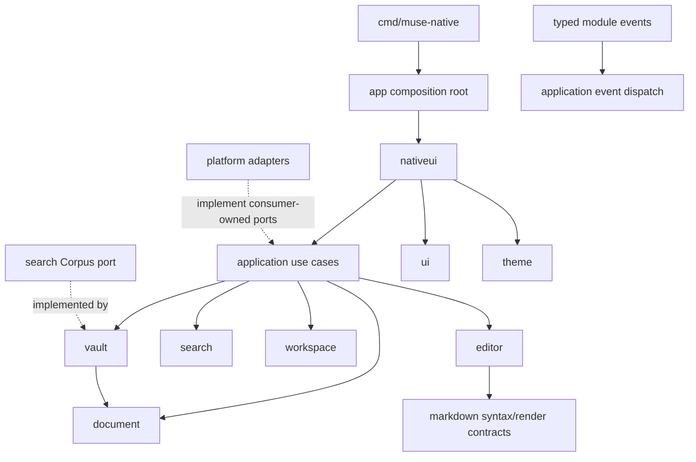

# Muse native architecture contract

Status: target architecture for the modular-monolith refactor. This document is the acceptance baseline for package moves and code wiring. If implementation disagrees with this contract, either change the implementation or record an explicit architecture decision here before continuing; do not silently preserve transitional structure.

## Goals

- Keep one native Go module and one desktop application while making feature ownership and dependency direction explicit.
- Allow roadmap features to add behavior through stable, typed module APIs rather than expanding `nativeui.App` or reaching into another module's internals.
- Keep document editing and Markdown rendering fast: avoid copies across package APIs, avoid per-frame global events, and keep caches/resource lifetimes with their owning feature.
- Complete the migration in one target architecture. Compatibility packages, duplicate implementations, old import paths, and temporary forwarding layers are not an acceptable end state.

## Target package tree

```text
native/
├── app/                           # composition root and module lifetime
├── cmd/muse-native/               # thin executable entry point
├── application/                   # cross-module user use cases
│   ├── document/                  # open/save/export note workflows
│   ├── vault/                     # open/switch/refresh vault workflows
│   └── workspace/                 # restore and persist session workflows
├── events/                        # minimal typed in-process event contract
├── document/                      # durable note model and policies
│   ├── frontmatter/
│   ├── repository.go              # note/recovery ports and domain errors
│   └── types/                     # stable value types only
├── vault/                         # vault identity and note relationships
│   ├── files/                     # discovery/catalog
│   ├── index/                     # note metadata and parsed structure projections
│   ├── links/                     # resolution/backlinks
│   └── watch/                     # watcher lifecycle and vault event policy
├── search/                        # query domain and search execution
│   ├── query/                     # syntax, AST, validation
│   ├── fields/                    # type/tags/time semantics
│   ├── plan/                      # query compilation/execution
│   ├── rank/                      # scoring and time-aware ranking
│   └── quickopen/                 # path/title/alias candidate matching and ranking
├── workspace/                     # tabs, active view, layout and restoration
├── editor/                        # public editing-session facade and composition
│   ├── input/                     # keymap, Vim modes and command interpretation
│   ├── navigation/                # source-position movement and structural navigation
│   ├── layout/                    # editor block geometry and virtualized layout policy
│   ├── blocks/
│   │   ├── inline/
│   │   ├── paragraph/
│   │   └── table/                 # table editing subsystem
│   └── internal/
│       ├── core/                  # editor-private buffer/transaction primitives
│       └── textlayout/            # editor-private text shaping/layout implementation
├── markdown/                      # public Markdown parse/render facade
│   ├── syntax/
│   ├── render/
│   ├── images/
│   ├── math/
│   └── diagrams/
├── agent/                         # AI session/tool/provider-independent flow
├── config/                        # serialized settings, defaults and migration
├── theme/                         # runtime palette and visual tokens
├── ui/                            # reusable UI primitives
│   ├── scrollbar/
│   └── iconlibrary/
├── nativeui/                      # Muse panels and presentation composition
│   ├── panels/
│   │   ├── filetree/
│   │   ├── outline/
│   │   ├── search/
│   │   ├── quickopen/
│   │   ├── properties/
│   │   ├── agent/
│   │   └── settings/
│   ├── components/
│   └── interactions/
├── platform/                      # OS/runtime adapters
│   └── filesystem/
│       ├── documentstore/         # concrete note/recovery persistence
│       ├── workspacestore/        # concrete workspace snapshot persistence
│       └── watcher/               # concrete filesystem watcher
└── locales/                       # localization data and generated catalog
```

The child entries in this tree are real Go package boundaries, not merely folders used to group files. `editor` and `markdown` are public facades; they should compose focused subsystems rather than retain the current large implementation bodies. A subsystem may stay in its parent package only when it shares private invariants that cannot yet be expressed through a narrow typed contract. Do not create one-file packages or empty forwarding shells just to match the tree.

`editor/internal/core` owns the editing buffer and transaction/history value semantics. `editor/input` turns toolkit-neutral key and text input into editor operations; `nativeui` translates MyGo events at its edge. `editor/navigation` owns movement policy and source-position navigation. `editor/layout` owns editor block geometry and virtualization policy, while `editor/internal/textlayout` owns shaping implementation details. `editor/blocks/*` owns the behavior and session state of each block subsystem; table syntax remains in Markdown parsing, while table selection and edits belong to `editor/blocks/table`.

`markdown/syntax` owns Markdown parsing and AST values. `markdown/render` maps parsed values to rendered blocks. `images`, `math`, and `diagrams` own their bounded media/rendering pipelines and caches; they expose results to the renderer without depending on the editor session. The root `markdown` package is the stable entry point for common parse/render operations.

`search/quickopen` owns fuzzy matching across candidate path, title, and aliases, including rank and rune-based highlight positions. The Quick Open panel only presents candidates and translates input into actions; it does not scan or rank the full catalog itself.

`nativeui` owns the application window and composes panels. Each panel package owns a view model and typed actions, receives data and capabilities through its public API, and returns actions to the root controller for use-case dispatch. Panel packages must not declare `package nativeui` in a child directory or reach the root `App`'s private fields. `components` owns reusable UI pieces such as document-type presentation and navigation icons; `interactions` owns shared focus, keyboard routing and drag/drop mechanics when more than one panel consumes them. Feature-specific policy remains in `application`, `vault`, `search`, `document`, or `agent` rather than in a panel package.

`textnav` may remain a small top-level pure algorithm package only while it is consumed by more than one editor capability; if it is editor-only after the refactor, move it under `editor/navigation`. `cachepath` belongs under `platform` only if it provides OS/runtime path policy; otherwise place it beside the feature that owns the cache. These are explicit audit decisions, not permission to retain old names indefinitely.

## Ownership and model boundaries

| Module | Owns | Must not own |
|---|---|---|
| `document` | Durable `Note` path identity, metadata, source/revision semantics, save/conflict/recovery policies | Cursor, selection, focus, scroll, widgets, parsed render nodes |
| `editor` | Mutable `Buffer`, edit transactions, undo/redo, selection, input mode, navigation and block editing | Vault indexing, persistence implementation, durable note identity, OS APIs |
| `markdown` | Markdown syntax/AST and derived rendering structures for inline, paragraph, table, image, math and diagrams | Durable note aggregate, editor selection/commands, application panel state |
| `vault` | Vault identity, file catalog, index lifecycle, link resolution/backlinks and watcher-to-vault policy | Search query language/ranking, native UI, document editing buffer |
| `search` | Query language/AST, field/operator meaning, execution plan, ranking and result contract | Filesystem traversal, concrete vault index layout, panel state |
| `workspace` | Open documents, active view, tabs/panes/layout, restoration snapshot and repository contract | Note source of truth, editor implementation internals, filesystem persistence |
| `application` | User workflows spanning modules, ordering, cancellation and transaction boundaries | Domain invariants that belong to a feature module |
| `nativeui` | Rendering, input translation, focus/panel state and calling use cases | Business rules, storage/index implementation, query execution |
| `config` / `theme` | Persisted settings schema vs derived runtime style values | Editor/document policy or interaction state machines |
| `ui` | Backend-neutral reusable UI behavior/components | Muse business concepts or platform-specific APIs |
| `platform` | OS/runtime implementations for dialogs, clipboard, filesystem, cache paths and resource access | Feature policy or view composition |

The current persistence model uses the normalized note path as identity. The repository does not persist a separate stable note ID or vault ID. Renaming or moving a note is therefore a delete plus create; do not synthesize a path hash and describe it as a stable identity. `document.Note` carries the current path, source, parsed metadata and disk revision. A future stable-ID migration must introduce persisted identity before changing this contract.

There are three separate representations of a note:

1. `document.Note` is the durable path-identified domain record and source/revision boundary.
2. `editor.Buffer` is the active mutable editing session and commits source changes as transactions.
3. `markdown`'s syntax/render tree is derived from a source revision and may be rebuilt or incrementally updated.

They must not be merged into one state object. Table syntax belongs to `markdown`; cell selection, hit testing, grid geometry and row/column commands belong to `editor/blocks/table`. Table edits commit through normal editor transactions. Fold/view mode is session state and is persisted by `workspace` only if restart restoration promises it.

## Dependency rules



- Domain packages do not import `nativeui`, MyGo widget packages, `platform`, or executable packages.
- `markdown` never imports `editor`; editor consumes parsed structures and owns edits.
- `search` owns the corpus/query contracts; `vault/index` implements the corpus contract without exposing its storage layout. `vault/index` also projects parsed link structure through an immutable narrow contract; `vault/links` owns path/title/alias resolution, outgoing links, backlinks, and their derived caches.
- Ports are declared by the module/use case that needs the capability. `document` owns note/recovery repository contracts and domain errors; `platform/filesystem/documentstore` implements them. `workspace` owns its snapshot repository contract; `platform/filesystem/workspacestore` implements it. Concrete filesystem, dialogs, clipboard, clock, image/font access and persistence implementations live in adapters.
- `app` is the only composition root that selects concrete implementations and registers extension contributions.
- No cycles, package-level mutable service locator, or broad `common`, `model`, `strategy`, or `utils` packages.

## Extension and lifecycle contracts

- `search` supports explicit typed field/operator/scorer registrations. Query parsing produces a validated AST; planning compiles it before execution. Metadata source belongs to `document`/`vault`; query semantics and ranking belong to `search`.
- `editor` block capabilities are explicit and typed. Block operations produce editor transactions; table selection/view state is scoped to its editor session.
- Registration IDs are unique and validated at application assembly. Do not add runtime plugin loading or a universal contribution framework until an actual third-party extension requirement exists.
- Domain event types are owned by the module that changes state (`document.DocumentSaved{Path, Revision}`, `workspace.WorkspaceRestored`). The application dispatches them to independent consumers; add a vault event only when a real independent subscriber needs one. Never publish per keystroke.
- Direct calls remain the default for a single workflow. Events are for independent subscribers; hooks are only for deliberate synchronous customization (e.g. a scorer or query operator).
- Coalesce editor changes by transaction/revision. Never broadcast per-frame layout, pointer movement, or every keystroke to a global bus.
- `app` owns process start/stop. Modules take contexts, cancel background work, and release subscriptions/resources when a vault, document session, or workspace closes.

## Completion and acceptance

The refactor is not complete merely because the code compiles. Before closing the goal:

1. Every implementation and test resides under its owning target module; old package directories/import namespaces are gone.
2. Module APIs and dependency direction match this document. UI panels use application/module APIs; no feature reaches through another feature's internals.
3. `nativeui.App` no longer owns document, index, search, or workspace domain state/rules that belong to feature modules.
4. Search, table editing, document save/recovery, workspace restore and Markdown render lifecycles have explicit owners and typed contracts.
5. No migration aliases, duplicate implementations, temporary package shells, stale architecture reference tree, or TODO-based transition path remains.
6. Focused package tests, full native tests, build, and architecture/import-boundary checks pass after all moves and wiring are complete.

Do not weaken these criteria to close the goal. If any criterion remains open, keep the goal active and continue the refactor.
