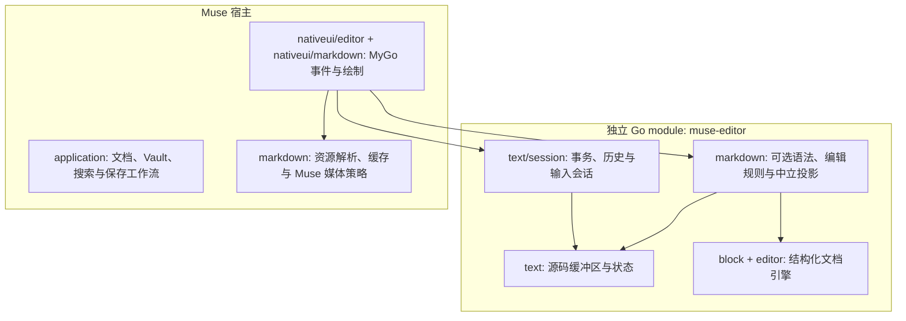

# Muse Editor 引擎边界与迁移方案

状态：目标架构决策，供后续拆分和验收使用。本文定义 `muse-editor` 与 Muse 的职责，不表示迁移已经完成。

## 目标

`muse-editor` 是可被其他 Go 程序导入的无 UI 编辑引擎。宿主能够创建会话、读取不可变编辑帧、提交操作，并按自己的工具包绘制界面。Muse 是一个宿主：负责 MyGo 视图、产品工作流、文件与 Vault 能力，并将宿主事件接入引擎。

本方案不要求 `muse-editor` 自带可直接显示的 MyGo 控件。它提供编辑核心和宿主契约；绘制、IME、文本 shaping、平台事件等由各宿主适配。若未来要提供完整可视组件，应作为独立视图/工具包适配层交付，不能让核心包依赖 MyGo。

## 目标依赖图

依赖只从宿主指向引擎。`muse-editor` 不导入 `muse`、MyGo、Muse 的平台/应用包或具体文件系统实现。
应用工作流不直接持有编辑器会话；`nativeui/editor` 是源码编辑会话的宿主和引擎适配边界。应用层仅通过文档用例处理打开、保存和恢复，编辑器 feature 将引擎帧与文档用例连接起来。图中的 `App` 和 `Media` 是不同职责的 Muse 模块，不表示 application 直接依赖 Muse 媒体实现。

## 包所有权

| 能力 | 所有者 | 契约 |
|---|---|---|
| 源码缓冲区、字节坐标、selection、transaction、mapping、history | `muse-editor/text` | 不解析 Markdown，不持有视图或文件状态 |
| 源码编辑会话、变更通知、输入意图、会话历史 | `muse-editor/text/session` | Muse 当前 Markdown 编辑使用的权威可变状态；解析树和渲染帧是派生值 |
| 结构化 block tree、schema、事务和结构化编辑状态 | `muse-editor/block`、`muse-editor/editor` | 独立于源码编辑会话的另一种引擎，不作为 Muse 源码会话的第二份状态 |
| Markdown 语法、源码偏移、codec、编辑计划和渲染中立模型 | `muse-editor/markdown/...` | 可选语言层；不得依赖 MyGo、Vault、Muse 文件路径或宿主状态 |
| Markdown 图片/公式/图表的 Muse 资源查找、持久缓存、路径限制和产品策略 | `muse/markdown/...` | 通过文件、缓存和解析能力接口工作；不拥有编辑事务或 undo/history |
| 原生输入、IME、命中测试、视口、文本 shaping、绘制与资源生命周期 | `muse/nativeui/editor`、`muse/nativeui/markdown` | 将 MyGo 事件转成引擎操作；消费不可变帧并绘制；不复制文档和历史状态 |
| 打开/保存/恢复、Vault 文件访问、链接解析和跨模块流程 | `muse/application/...`、`muse/platform/...` | 由应用工作流和平台适配持有，不进入编辑引擎 |

### Markdown 解析快照

源码编辑路径以 `markdown/syntax` 的增量语法模型作为显示、源码范围和编辑上下文的权威来源。`markdown/edit` 提供源码编辑计划；它不应在每个按键/命令中独立重解析，也不应与显示解析对同一语法作出不一致判断。目标是由每个 source revision 产生可复用的解析快照，供投影和编辑计划共同消费；若某个编辑计划确实需要 Goldmark AST，应由快照构建一次并复用，且用 conformance tests 验证它与权威语法在该计划所依赖语义上的一致性。

`markdown/codec` 服务结构化 block 文档的 Markdown 导入/导出，是另一种编辑模型的 codec；它可使用自己的 Goldmark 投影和 source-span 保真策略，不是 Muse 当前源码编辑显示树的第二个权威 parser。不要把 codec AST、源码语法投影和编辑计划快照混成一个模型，也不要为它们复制可变文档或 undo/history。

### 两种编辑模型

`text/session` 与结构化 `editor`/`block` 是并列选项，不能互相代理或共享可变文档状态。Muse 当前以 Markdown 源码为唯一编辑状态，渲染树由源码派生。保持此约束，避免应用同时维护文本历史和 block 历史。

公共文档必须明确标注：`text/session` 用于源码编辑；`editor`/`block` 用于消费者主动选择结构化文档模型。不要把根包 `editor` 描述为 Muse 当前源码编辑器的内部实现。

## 依赖与 API 规则

1. 引擎公开值类型、状态转换和窄接口；不公开 Muse 的 `Editor`、MyGo 对象、Vault 对象或可变缓存。
2. `Session.Frame` 只包含提交给宿主所需的稳定值。语法树、渲染投影、viewport、图片资源由各自的派生层持有。
3. 宿主输入通过中立事件/操作或事务进入引擎。MyGo key、IME range、鼠标坐标和绘制命令只能出现在 Muse 适配包。
4. Markdown 编辑规则返回确定的编辑计划或事务；Muse 负责提供产品能力、校验宿主上下文并提交结果。Markdown 包不得直接保存文件或查找 Vault。
5. 媒体渲染使用消费者提供的文件/缓存能力。引擎不得自行读取工作目录、发起产品级文件查找或保留平台句柄。
6. Go 包依赖不得形成反向导入。`muse-editor` 中的核心包不依赖 `markdown`；Markdown 通过 adapter/extension 依赖核心。
7. 一个概念只保留一个正式定义。Muse facade 可组合引擎 API 或增加 Muse 策略，不为每个引擎包复制一层纯类型别名。

## 迁移步骤

### 1. 固定公开入口

- 将 `muse-editor/text/session` 定为 Muse 当前源码编辑的引擎入口。
- 将 `muse-editor/editor` 与 `muse-editor/block` 明确记录为独立的结构化编辑 API。
- 为两个入口各保留一个可从 `muse-editor` 仓库直接运行的最小示例；示例不导入 Muse。
- 在 `muse-editor` README/API 文档中列出宿主必须实现的视图职责和可选 Markdown 能力。

**完成条件：** 新消费者不需要阅读 Muse 源码就能选对编辑模型，并能创建会话、提交修改、读取结果。

### 2. 收敛 Markdown 边界

- 语法、offset 映射、Markdown 编辑计划和中立 render projection 留在 `muse-editor/markdown`。
- Muse 的 Vault 路径解析、文件访问、资源缓存持久化和原生资源生命周期留在 Muse。
- Muse 专属语法或交互规则只有在需要可配置/可禁用时才拆为显式 Markdown 扩展；不要为目录对称而新建空包或转发包。
- 保持 `nativeui/markdown` 为 MyGo 绘制层；它消费中立 Markdown projection，通过窄回调交互。

**完成条件：** 引擎 Markdown 包可脱离 Muse 测试和使用；图片/公式等宿主能力由 Muse 显式提供；解析和渲染投影没有 MyGo 或 Vault 依赖。

### 3. 清理 Muse 转发层

- `native/editor` 只保留确有应用消费者的 Muse 组合 API；编辑状态、事务和输入模型的权威定义仍在 `muse-editor`。
- 将 `nativeui/editor` 的引擎导入统一为 `muse-editor` 正式包路径；移除无独立 Muse 行为的子包 facade。
- `native/markdown` 只保留 Muse Markdown 产品入口和资源/策略实现；纯 alias/import-export 包迁移消费者后删除。
- 调整 package comments、README 和架构文档，使其描述完成后的边界，不再把临时兼容层写成目标职责。

**完成条件：** 每个保留的 Muse facade 都有明确消费者和产品行为；不存在仅转发的重复 API；没有双向依赖或重复状态。

### 4. 建立可复现的独立消费方式

- 给 `muse-editor` 发布并维护正式 Go module 版本；Muse 的 `native/go.mod` 固定使用正式版本。
- 个人联调可用未提交的 `go.work`，不得把某台机器的绝对路径写进提交内容。
- 独立示例和消费者检查使用正式版本解析；更新 Muse 时同步更新引擎版本。

**完成条件：** 在不含 `muse-editor` 本地 checkout 的干净环境中，Muse 和独立示例都能解析同一固定版本。

## 验收清单

- [ ] `muse-editor` 核心包不导入 Muse、MyGo、平台文件系统和应用工作流。
- [ ] `text/session` 是 Muse Markdown 编辑的唯一可变文档与历史权威。
- [ ] 结构化 block 引擎作为独立选项记录，没有被误称为 Muse 源码编辑的底层状态。
- [ ] Markdown 解析和编辑计划不读取 Vault、不写文件；MyGo 绘制只在 Muse `nativeui`。
- [ ] 源码编辑每个 source revision 只建立可复用的语法上下文；显示投影与编辑计划消费同一权威语义，或通过明确的 conformance gate 证明所需语义一致；普通命令不触发重复全量解析。
- [ ] 引擎外部示例能够创建、修改并读取文档，不需要 Muse 构造函数或类型别名。
- [ ] Muse 对 `muse-editor` 的依赖使用固定版本；提交文件没有绝对本机 `replace` 路径。
- [ ] 所有保留的 facade 都有明确行为和消费者；无纯转发包、重复 session、重复 undo/history 或重复 parser AST。

## 当前状态说明

当前分支已有 `muse-editor` 独立模块、源码 session、Markdown 语法/中立投影和 Muse NativeUI 绘制层，方向符合目标。`nativeui/editor` 仍需按 `docs/architecture.md` 的 Editor UI ownership 方案收敛：保留已有真正独立的 render、IME、input adapter、table/media 子系统；先在现有 Go package 内把 Editor 状态归入具名 owner，再抽取具备窄 typed contract 的职责，不能只移动文件或暴露整个 `*Editor`。

仍需按上述步骤核验 facade 是否只是迁移转发、统一正式导入路径、让源码编辑解析快照按 revision 复用，并完成可复现的模块版本消费。该清单是后续迁移验收，不将当前代码结构自动视为已达标；Muse NativeUI 目录细分和 `Editor` 私有状态分组的详细布局以 `docs/architecture.md` 为准。
