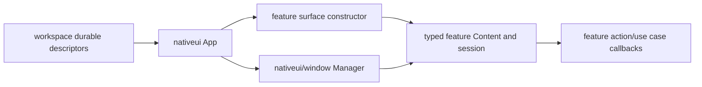

# Window and Surface Host API Draft

## Boundary

`nativeui/window` owns live window, pane, and overlay placement, focus order,
modal exclusivity, and lifecycle. A feature surface owns its typed state,
rendering, decoding, and feature actions. `App` asks the manager to open,
close, focus, or place a surface and retains only an opaque handle plus a
portable window/Pane placement. The manager has no feature-specific factory
registry and never converts a request into an untyped state value.

The current manager hosts logical panes and overlays inside the MyGo app
window. Creation and closure of native top-level OS windows belong to the
platform/runtime host adapter. The manager does not use a MyGo global window
singleton. If true multi-window hosting is needed later, add a Host capability
without mixing it with feature surface state.

## Public API

```go
type HostID string
type PaneID string

type Layer uint8
const (
    PaneContent Layer = iota
    Overlay
    ModalOverlay
)

type Placement struct {
    Host  HostID
    Pane  PaneID // used for PaneContent; ignored for Overlay
    Layer Layer
}

type Handle struct { /* opaque manager identity */ }

type Content interface {
    Render(*ui.Context)
    Close()
}

type Controls interface {
    CloseSelf()
    FocusSelf()
}

type Bindable interface { Bind(Controls) }
type FocusLifecycle interface {
    Focused()
    Blurred()
}

func NewManager(fallbackFocus func()) *Manager
func (m *Manager) Open(Content, Placement) (Handle, error)
func (m *Manager) Close(Handle) error
func (m *Manager) Focus(Handle) bool
func (m *Manager) FocusedPane(HostID) (PaneID, bool)
func (m *Manager) Place(Handle, Placement) error
func (m *Manager) Render(*ui.Context, HostID, Layer)
func (m *Manager) RenderPane(*ui.Context, HostID, PaneID)
func (m *Manager) HandleEscape() bool
func (m *Manager) HasModal() bool
func (m *Manager) CloseAll()
```

Manager mutation, rendering, and content callbacks run on the UI-owner thread.
The manager does not add a goroutine or mutex around renderer/session state.

Signatures are illustrative; the implementation may choose equivalent Go
names while preserving this ownership and behavior.

## Lifecycle and interaction rules

1. A feature constructor creates its typed session and `Content`, then the
   caller supplies that content to `Manager.Open`. The manager assigns an
   opaque handle and records placement. A content implementing `Bindable`
   receives generic lifecycle controls after it opens.
2. `Render` visits content for one host/layer in placement order. The content
   translates its own input into typed feature actions. Generic close buttons
   call `Controls.CloseSelf`; the manager does not interpret those actions.
3. At most one modal surface may be open. `ModalOverlay` is modal; opening a
   second modal returns `ErrModalAlreadyOpen`. The caller explicitly closes
   the old surface first.
4. `HandleEscape` closes the active modal, consumes the key, and restores focus
   to the previously focused surface. If it has closed, the fallback supplied
   to `NewManager` restores focus to the editor.
   File-tree/editor key routing runs only when `HandleEscape` returns false.
5. `Close` removes the surface from placement and focus order, invokes
   `Content.Close` exactly once, then restores focus if the closed surface was
   focused. `CloseAll` applies the same cleanup to process shutdown.
6. `FocusedPane(host)` returns the latest pane whose content received focus.
   Focusing an overlay preserves that pane context; removing its last content
   selects another remaining pane in the same host or returns no pane. This is
   a generic routing context, not access to editor or document state.
7. Feature surfaces such as image preview, image document, Quick Open, and
   Mermaid preview keep zoom, query, decoded bitmap, diagram model, and other
   feature state private. Editor preview callbacks ask a feature-owned opener
   to create content, then call generic `Manager.Open` and retain its handle.
8. Opening or closing an editor image preview never edits the document source
   or changes the caret. Escape closes the modal and returns focus to the
   editor. Quick Open receives query input but delegates ranking to
   `search`/`application`; Mermaid preview receives a typed diagram model and
   owns only its viewport state.

## Persistence

Transient overlays (Quick Open, image preview, Mermaid preview) are not
restored. Workspace persistence may store only durable document/pane state,
such as the active Markdown path and pane placement. It never stores
`Content`, handles, widgets, bitmap data, query caches, or feature state.
Generic descriptor-based surface restoration is a later capability; this API
does not add a generic factory registry.

The manager can retain several opaque contents per pane, activate one through
`Focus(handle)`, and render only that active content through `RenderPane`. It
does not own tab ordering/presentation or split geometry. The durable workspace
model owns the split tree, tab order, and active document per pane. A future
layout presenter maps that model to pane slots and calls `RenderPane` for each
slot; it must not make the manager aware of documents, editor sessions, or
feature-specific state.

## Dependency direction


