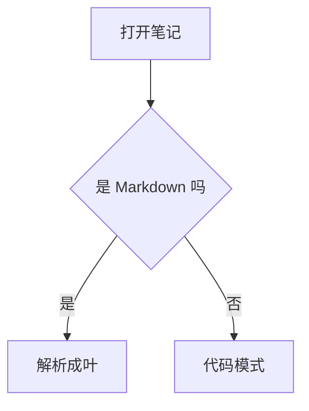

# 各类内容一览

这是一段普通正文，用来检查行内语法的展开与收起：**粗体**、*斜体*、~~删除线~~、`行内代码`、
[链接](https://example.com)、[[双链]]、[[双链|带标签]]、#标签 #回归/编辑器，以及行内公式 $a^2+b^2=c^2$。

行内注释在这里：正文前 %%这是一段注释%% 正文后。它平时应该隐藏，光标进去才展开。

一个硬换行：

这一行接着写，用来检查单换行在排版里是否成行。
第二行。

## 二级标题

### 三级标题

#### 四级标题

##### 五级标题

###### 六级标题

## 列表

- 第一项
- 第二项
  - 嵌套的一层
  - 再一项
- 第三项

1. 有序第一
2. 有序第二
   1. 嵌套有序
3. 有序第三

- [ ] 未完成的待办
- [x] 已完成的待办
- [ ] 另一个待办

## 引用与 callout

> 普通引用。
> 第二行。

> [!NOTE] 提示
> callout 的第一段。
>
> callout 的第二段，中间隔着一个 `>` 空行。

> [!WARNING]
> 这是一个警告。
> > 嵌套引用里的一段。

## 表格

| 左对齐 | 居中 | 右对齐 |
| :--- | :---: | ---: |
| 甲 | **乙** | 3 |
| 一行比较长的内容，用来看看换行 | `code` | 42 |
| [[双链]] | $x^2$ | 注释 %%隐藏%% 而已 |

## 代码

```go
func main() {
	println("hello, muse")
}
```

```js
const el = document.querySelector("#app");
console.log(el?.innerText ?? "");
```

```
没有语言标记的围栏
```



## 公式

$$
\int_0^1 x^2 \, dx = \frac{1}{3}
$$

## 图片

这一段里有一张内联图片：前  后。


## HTML 与其它

<span style="color:red; font-weight:bold">红色粗体</span>，还有 <font color="#00f">蓝色</font>。

<details>
<summary>折叠块</summary>

里面的内容。

</details>

---

分隔线上面和下面各一段。

引用脚注[^note]。

[^note]: 这是脚注的内容，折行看看。

## 边界情况

`%%不是注释%%`（行内代码里的百分号）。

\%\% 转义过的百分号。

正文 %%多行注释
第二行
第三行%% 正文继续。

一个很长的段落，用来检查换行与滚动：在很长很长的文本里，排版应当把每一行都摆对，光标应当能落在任意两字之间，方向键上下移动应当尽量保持列的位置，而不该常常跳到行首行尾。再加一些标点，逗号、句号、顿号、括号（圆括号）、【方括号】、「引号」，以及英文单词 an occasional English sentence to check mixed script wrapping and the baseline alignment of latin letters beside CJK glyphs in the same line.

| 只有表头的表 |
| --- |
