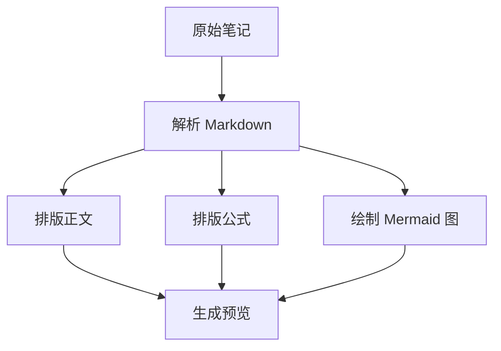

# Rendering Notes

This note records the rendering choices for Atlas. The architecture overview's
[[Atlas Overview#Architecture|architecture section]] describes the larger
system; this page focuses on how a note becomes a readable preview.

## A document from source to preview

The editor keeps Markdown editable while drawing the result directly in the
document. A small change should update only the affected view, so long notes
remain comfortable to work with.

When the caret enters a diagram block, its source is shown in place. The
diagram remains the preview when the caret moves away.

## Formula layout

Inline formulas should sit naturally in a sentence. For example, sorting
`n` items takes $O(n \log n)$ comparisons, while the average of `n` scores is
$\bar{x} = \frac{1}{n}\sum_{i=1}^{n} x_i$.

For a separate display, the harmonic mean of precision and recall is:

$$
F_1 = 2 \cdot \frac{P \cdot R}{P + R}
$$

The source should remain easy to inspect while editing: commands such as
`\frac` and `\sum`, braces, operators and numbers receive distinct colors.
Moving the caret out restores the typeset formula.

## Review checklist

- The flowchart labels and arrows remain legible at the current page width.
- Inline formulas align with the surrounding sentence and wrap cleanly.
- The display formula keeps its own breathing room above and below.
- Source text stays byte-for-byte intact while its syntax colors appear.
